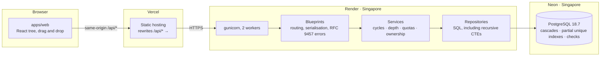

# File Explorer

A multi-user hierarchical folder manager — create, rename, move and delete folders and files in
a tree of arbitrary depth, over a REST API backed by PostgreSQL. No file contents are stored,
only structure.

**The API is deployed and you can check it from here:**
[`/api/v1/health`](https://file-explorer-api-xgxr.onrender.com/api/v1/health) — it runs
`SELECT 1` before answering, so a `200` means the database replied, not merely that the process
is alive. *First request after fifteen idle minutes takes 30–60 seconds: the instance is on a
free plan and spins down.*

> **Status, honestly.** Both halves are deployed and they are one origin:
> [file-explorer-frontend.vercel.app](https://file-explorer-frontend.vercel.app) builds from
> this repository and rewrites `/api/*` to the Render service, so the session cookie is
> same-site and no CORS header is ever sent. `apps/web` is Vite 7, React 19 and TypeScript 5:
> a drag-and-drop tree, a cold-start wait that explains itself instead of reporting `502`,
> and both ways in — one-click guest, or an email and password.
> **Open it cold and the first request takes 30–60 seconds**; the page says so while it waits.

---

## The bug worth understanding

The original version worked, and had a bug worth understanding: moving a folder into its own
descendant created a cycle. No error was raised and no row was corrupted — but the subtree
stopped being reachable from the root, so to the user the data had vanished.

Fixing that properly is more interesting than it first appears. A descendant check is the
obvious answer, and it is not sufficient: two concurrent moves can each pass that check against
a tree that is still valid at the moment they look, and commit a cycle between them. The real
fix runs the check inside a transaction that row-locks the node being moved together with the
destination's ancestry chain, in a deterministic order — and the lock that does the work is the
one on the moved node, not the chain.

That problem, and the tests that prove it is solved, is what this rebuild is about.
[`test_concurrent_move_four_cycle`](apps/api/tests/test_concurrency.py) is the one to read: a
two-node race often serialises by luck and passes against a broken implementation, so the test
uses four nodes across two trees, moved in a ring.

---

## Architecture



The rewrite is not a deployment detail. `*.vercel.app` and `*.onrender.com` are different sites
under the Public Suffix List, so a `SameSite=Lax` session cookie set by the API would be refused
at storage time on a cross-site response — the demo could never have signed in. Routing
`/api/*` through Vercel makes every browser request same-origin, which also means the API sends
no CORS headers at all and needs no allowlist. `create_app` refuses to start on a cookie
configuration that cannot work, because this is not the kind of mistake that surfaces in a test.

Rules that must never be violated live in the database as constraints. Rules that need a good
error message live in the service layer. Most live in both.

---

## The API

Eleven paths and twelve operations, published as an [OpenAPI 3.0.3 document](apps/api/docs/openapi.json) that is
generated, committed, and compared against the live application in CI — a drifted document
fails the build rather than misleading a client.

| Method | Path | What it does |
|---|---|---|
| `POST` | `/api/v1/auth/register` | Create an account. **Answers `202` whether or not the address was taken** — a different answer is an account-existence oracle |
| `POST` | `/api/v1/auth/login` | Open a session. `200` with the CSRF token, or `401` |
| `POST` | `/api/v1/auth/guest` | **One click, no form, no email.** A demo session with a seeded ten-node tree |
| `POST` | `/api/v1/auth/logout` | End this session. The row is deleted, so the cookie cannot be replayed |
| `GET` | `/api/v1/auth/me` | Who this session belongs to, and the CSRF token to echo back |
| `GET` | `/api/v1/roots` | One page of the caller's root folders and files |
| `POST` | `/api/v1/nodes` | Create a folder or a file. `parent_id: null` creates a root |
| `PATCH` | `/api/v1/nodes/{id}` | Rename in place |
| `DELETE` | `/api/v1/nodes/{id}` | Delete a node and everything under it |
| `GET` | `/api/v1/nodes/{id}/children` | One page of a folder's contents. **A file is a `409`, not an empty page** |
| `GET` | `/api/v1/nodes/{id}/path` | Breadcrumbs, root first |
| `POST` | `/api/v1/nodes/{id}/move` | Re-parent. `new_parent_id: null` moves it to the root |

Plus `GET /api/v1/health`, which is outside the document because it is for the platform, not for
clients.

**Every failure is an [RFC 9457](https://www.rfc-editor.org/rfc/rfc9457) problem document**,
including the ones the framework raises on its own — 404 on an unrouted path, 405, 413 over the
body cap, 429 from the rate limiter. An API that is careful about the errors it thought of and
falls back to the framework for the rest makes a client handle two shapes.

**A node belonging to someone else is `404`, never `403`.** Ids are sequential, so `403` would
confirm the row exists and make them enumerable. A test walks `app.url_map`, takes every rule
with a `node_id`, and drives each of its methods against another owner's node — a hand-written
list of routes is a thing somebody forgets to extend.

### Sessions

An opaque session id in a `sessions` table, not a JWT. A JWT buys verification without touching
the database; this application queries PostgreSQL on every request from a single instance, so
that benefit can never be collected while every cost — unrevocable tokens, key rotation, a
refresh-token table anyway — is still paid. The row's primary key is the SHA-256 of the cookie
value, and it cascades from `users`, so deleting an account ends its sessions in the same statement.

Passwords are argon2id at **OWASP's minimum** — 19456 KiB, t=2, p=1 — rather than the library's
defaults, which want roughly 64 MiB and four lanes and do not fit a 512 MB instance. CSRF is a
synchronizer token stored in the session row, not double-submit, which compares a request to
itself.

---

## The data model

An **adjacency list** — each node stores its parent. Chosen because the defining operation here
is moving a subtree, and that is a single-row update in an adjacency list, where a nested set
would renumber much of the table and a materialised path would rewrite every descendant.

```
nodes
  id         bigserial  primary key
  owner_id   bigint     → users(id)  on delete cascade
  parent_id  bigint     → nodes(id)  on delete cascade   -- NULL means root
  name       varchar(255)
  type       enum('file','folder')

  index  (owner_id, parent_id)
  unique (parent_id, name) where parent_id is not null
  unique (owner_id, name)  where parent_id is null
  unique (id, owner_id)
  check  (parent_id is distinct from id)
  check  (length(btrim(name, E' \t\n\r\f\v')) > 0)
  foreign key (parent_id, owner_id) -> nodes (id, owner_id) on delete cascade
```

That last line is the one worth noticing. A plain `parent_id -> id` foreign key constrains the
id and nothing else, so a node could be attached under a parent belonging to a different user —
and that user deleting the folder would cascade into it. Referencing the `(id, owner_id)` pair
makes a cross-owner parent a foreign key violation, whatever the application layer forgets.
`MATCH SIMPLE` skips the check when `parent_id` is null, which is exactly what a root needs.

Two partial unique indexes rather than one constraint, because PostgreSQL treats NULLs as
distinct for uniqueness — a plain `unique (parent_id, name)` would permit unlimited duplicate
names at the root.

The collation on every index that orders or compares a name is pinned to `C`, so ordering is
byte order everywhere and a keyset cursor cannot disagree with the index it pages through.

The eight invariants this schema and its service layer maintain are listed in
[`docs/ARCHITECTURE.md` §4](docs/ARCHITECTURE.md), each with the test that proves it.

---

## Tests

281 against **real PostgreSQL 18.7** in GitHub Actions — the same major version the deployed
database runs — and never SQLite. Recursive CTEs, `SELECT … FOR NO KEY UPDATE` and partial
unique indexes all behave differently there, so a suite that passes on SQLite has tested a
different program.

Branch coverage is a **gate**, not a report: CI runs `--fail-under=99.5` and the suite currently measures 99.62%. It has earned that: deleting three health
tests once left every remaining test passing and only the floor noticed.

Coverage says a line ran, not that a guard works. So twenty-one mutations are recorded in
[`docs/MUTATIONS.md`](docs/MUTATIONS.md), twenty of them with the CI run that caught them — and two of those
runs taught something the practice needed: **a mutation that fails to apply looks exactly like a
guard that works.** One replaced the first of two identical lines; another stripped a decorator
without its indentation and produced a syntax error that read, at a glance, like a test failure.

---

## Layout

```
apps/api     Flask API — PostgreSQL, SQLAlchemy, Alembic, flask-smorest
apps/web     React frontend — Vite 7, React 19, TypeScript 5, deployed on Vercel
docs/        architecture, security, ADRs, the change log
render.yaml  the deployed API, as a file rather than as dashboard settings
vercel.json  the rewrite that makes the session cookie same-site
```

Both application directories carry their original history from the two repositories this
replaces, with a committed virtualenv removed from every commit.

`render.yaml` exists because the running system previously existed only as dashboard settings —
no `Procfile`, no `Dockerfile`, nothing. Nobody could recreate it, and when it broke nobody could
see what it had been. Ten tests keep it honest, including one that fails if the service name it
declares stops matching the host `vercel.json` rewrites to.

---

## Running it

```bash
git clone https://github.com/vinay1500/file-explorer.git
cd file-explorer
make help      # every available command
```

**What works today:** `make help` lists the commands, and `make db` starts PostgreSQL 18 if you
have Docker. *That path has not been exercised here* — nothing in this project installs on the
development machine, so CI is where every command is actually proven, and saying otherwise would
be a claim nobody has tested.

**What does not work yet:** `make up`, `make test-api` and the other container targets. There
are no application images, so those fail with a pointer rather than a confusing build error.
This section gets updated as each one starts working — see the
[change log](docs/book/CHANGELOG.md) for what landed when.

The suite is in [`.github/workflows/ci.yml`](.github/workflows/ci.yml); the `tests` job is the
one to read.

---

## Documentation

| | |
|---|---|
| [docs/ARCHITECTURE.md](docs/ARCHITECTURE.md) | Data model, the eight invariants, the move algorithm, API conventions |
| [docs/SECURITY.md](docs/SECURITY.md) | Threat surface, and the test that enforces each rule |
| [docs/adr/](docs/adr/) | Five decision records, including why not `SERIALIZABLE` |
| [docs/MUTATIONS.md](docs/MUTATIONS.md) | Twenty-one mutation runs. Twenty carry the CI id that caught them; the twenty-first reddens a *build* and was verified locally |
| [docs/book/](docs/book/) | The long-form write-up, a chapter per problem |
| [docs/DESIGN-SYSTEM.md](docs/DESIGN-SYSTEM.md) | Written ahead of the frontend rebuild. **Specifies more than exists** — treat it as the target, not a description |
| [CONTRIBUTING.md](CONTRIBUTING.md) | Project rules, commit conventions, definition of done |

---

## Licence

MIT. See [LICENSE](LICENSE).
