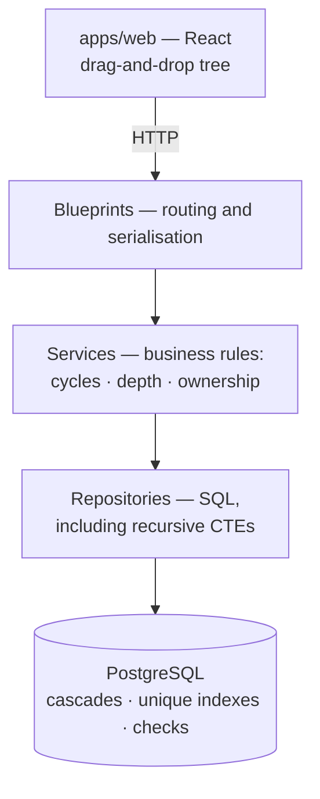

# File Explorer

A multi-user hierarchical folder manager — create, rename, move and delete folders and files in
a tree of arbitrary depth, through a drag-and-drop interface backed by a REST API over
PostgreSQL. No file contents are stored, only structure.

> **Status: rebuild in progress.**
> This repository began in April 2025 as two separate repos. It is being rebuilt in the open —
> the commit history below that point is the original. What is documented in
> [`docs/ARCHITECTURE.md`](docs/ARCHITECTURE.md) is the **target**, and that document marks what
> exists today versus what is planned. Nothing here claims to be finished.

---

## Why this exists

The original version worked, and had a bug worth understanding: moving a folder into its own
descendant created a cycle. No error was raised and no row was corrupted — but the subtree
stopped being reachable from the root, so to the user the data had vanished.

Fixing that properly is more interesting than it first appears. A descendant check is the
obvious answer, and it is not sufficient: two concurrent moves can each pass that check against
a tree that is still valid at the moment they look, and commit a cycle between them. The real
fix runs the check inside a transaction that row-locks the node being moved together with the
destination's ancestry chain, in a deterministic order — and the lock that does the work is the
one on the moved node, not the chain.

That problem — and the tests that prove it is solved — is what this rebuild is about.

---

## Architecture



Today only the bottom of that diagram exists: the schema and its constraints. The service,
repository and blueprint layers, cookie authentication and generated API types are the target,
and the frontend is still the original Create React App code.

Rules that must never be violated live in the database as constraints. Rules that need a good
error message live in the service layer. Most live in both.

### The data model

An **adjacency list** — each node stores its parent. Chosen because the defining operation here
is moving a subtree, and that is a single-row update in an adjacency list, where a nested set
would renumber much of the table and a materialised path would rewrite every descendant.

```
nodes
  id         bigserial  primary key
  owner_id   bigint     → users(id)  on delete cascade
  parent_id  bigint     → nodes(id)  on delete cascade   -- NULL means root
  name       varchar(255)
  type       enum('file','folder')

  index  (owner_id, parent_id)
  unique (parent_id, name) where parent_id is not null
  unique (owner_id, name)  where parent_id is null
  unique (id, owner_id)
  check  (parent_id is distinct from id)
  check  (length(btrim(name, E' \t\n\r\f\v')) > 0)
  foreign key (parent_id, owner_id) -> nodes (id, owner_id) on delete cascade
```

That last line is the one worth noticing. A plain `parent_id -> id` foreign key constrains the
id and nothing else, so a node could be attached under a parent belonging to a different user —
and that user deleting the folder would cascade into it. Referencing the `(id, owner_id)` pair
makes a cross-owner parent a foreign key violation, whatever the application layer forgets.
`MATCH SIMPLE` skips the check when `parent_id` is null, which is exactly what a root needs.

Two partial unique indexes rather than one constraint, because PostgreSQL treats NULLs as
distinct for uniqueness — a plain `unique (parent_id, name)` would permit unlimited duplicate
names at the root.

The eight invariants this schema and its service layer maintain are listed in
[`docs/ARCHITECTURE.md` §4](docs/ARCHITECTURE.md), each with the test that proves it.

---

## Layout

```
apps/api     Flask API — PostgreSQL, SQLAlchemy, Alembic
apps/web     React frontend
docs/        architecture, security, design system
```

Both application directories carry their original history from the two repositories this
replaces, with a committed virtualenv removed from every commit.

---

## Running it

```bash
git clone https://github.com/vinay1500/file-explorer.git
cd file-explorer
make help      # every available command
```

**What works today:** `make help` lists the commands, and `make db` starts PostgreSQL 17 if
you have Docker. *That path has not been exercised here* — development runs against the
PostgreSQL service container in CI, so CI is where every command is actually proven.

**What does not work yet:** `make up`, `make test-api` and the other container targets. There
are no application images, so those fail with a pointer rather than a confusing build error.
This section gets updated as each one starts working — see the
[change log](docs/book/CHANGELOG.md) for what landed when.

**The tests do run**, in CI, against PostgreSQL 17 — never SQLite. Recursive CTEs,
`SELECT … FOR NO KEY UPDATE` and partial unique indexes all behave differently there, so a suite
that passes on SQLite has tested a different program. See
[`.github/workflows/ci.yml`](.github/workflows/ci.yml); the `tests` job is the one to read.

---

## Documentation

| | |
|---|---|
| [docs/ARCHITECTURE.md](docs/ARCHITECTURE.md) | Data model, invariants, the move algorithm, API conventions |
| [docs/SECURITY.md](docs/SECURITY.md) | Threat surface, and the tests that will enforce it |
| [docs/DESIGN-SYSTEM.md](docs/DESIGN-SYSTEM.md) | Tokens, component states, accessibility |
| [CONTRIBUTING.md](CONTRIBUTING.md) | Project rules, commit conventions, definition of done |
| [docs/adr/](docs/adr/) | Five decision records, including why not `SERIALIZABLE` |
