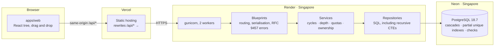

# File Explorer

A multi-user folder tree. You can create, rename, move and delete folders and files at any
depth, over a REST API backed by PostgreSQL. It stores structure, not file contents.

**[Open the demo](https://file-explorer-frontend.vercel.app).** One click gets you a guest
account with a few folders in it, and whatever you do there is yours alone. The first request
after a quiet spell takes 30 to 60 seconds, because the server is on a free plan and goes to
sleep; the page tells you that while you wait rather than showing you an error.

You can also check the API yourself:
[`/api/v1/health`](https://file-explorer-api-xgxr.onrender.com/api/v1/health) runs `SELECT 1`
before it answers, so a `200` means the database replied, not just that the process is up.

I built the first version of this in April 2025 and it ran for seventeen months with four bugs
in it that nobody noticed. This repository is the rebuild, and the write-up of what was wrong is
the point of it.

---

## The bug worth understanding

The original version worked, and it had a bug worth understanding. Moving a folder into its own
descendant created a cycle. Nothing raised an error and no row was corrupted, but the subtree
stopped being reachable from the root, so as far as anyone using it could tell, their data had
vanished.

Fixing that properly turned out to be more interesting than I expected. The obvious answer is to
check whether the destination is a descendant before you move, and that is not enough: two
moves running at the same time can each pass that check against a tree that is genuinely valid
when they look at it, and commit a cycle between them. The real fix runs the check inside a
transaction that row-locks the node being moved along with the destination's ancestry chain, in
a fixed order. The lock that does the work is the one on the moved node, not the chain, which I
had backwards at first.

That problem, and the tests that prove it is solved, is what this rebuild is about.
[`test_concurrent_move_four_cycle`](apps/api/tests/test_concurrency.py) is the one to read: a
two-node race often serialises by luck and passes against a broken implementation, so the test
uses four nodes across two trees, moved in a ring.

---

## Architecture



The rewrite in the middle is not a deployment detail. `*.vercel.app` and `*.onrender.com` are
different *sites* under the Public Suffix List, so a `SameSite=Lax` session cookie set by the
API would have been refused by the browser at storage time. The demo could never have signed
anybody in. Routing `/api/*` through Vercel makes every request same-origin, which also means
the API sends no CORS headers at all and needs no allowlist. `create_app` refuses to start on a
cookie configuration that cannot work, because this is not the kind of mistake that shows up in
a test.

Rules that must never be violated live in the database as constraints. Rules that need a good
error message live in the service layer. Most live in both.

---

## The API

Eleven paths and twelve operations, published as an
[OpenAPI 3.0.3 document](apps/api/docs/openapi.json) that is generated, committed, and compared
against the live application in CI. A document that has drifted fails the build instead of
misleading whoever is reading it.

| Method | Path | What it does |
|---|---|---|
| `POST` | `/api/v1/auth/register` | Create an account. **Answers `202` whether or not the address was taken.** Any other answer tells a stranger who has an account here |
| `POST` | `/api/v1/auth/login` | Open a session. `200` with the CSRF token, or `401` |
| `POST` | `/api/v1/auth/guest` | **One click, no form, no email.** A demo session with a seeded ten-node tree |
| `POST` | `/api/v1/auth/logout` | End this session. The row is deleted, so the cookie cannot be replayed |
| `GET` | `/api/v1/auth/me` | Who this session belongs to, and the CSRF token to echo back |
| `GET` | `/api/v1/roots` | One page of the caller's root folders and files |
| `POST` | `/api/v1/nodes` | Create a folder or a file. `parent_id: null` creates a root |
| `PATCH` | `/api/v1/nodes/{id}` | Rename in place |
| `DELETE` | `/api/v1/nodes/{id}` | Delete a node and everything under it |
| `GET` | `/api/v1/nodes/{id}/children` | One page of a folder's contents. **A file is a `409`, not an empty page** |
| `GET` | `/api/v1/nodes/{id}/path` | Breadcrumbs, root first |
| `POST` | `/api/v1/nodes/{id}/move` | Re-parent. `new_parent_id: null` moves it to the root |

Plus `GET /api/v1/health`, which is outside the document because it is for the platform, not for
clients.

**Every failure is an [RFC 9457](https://www.rfc-editor.org/rfc/rfc9457) problem document**,
including the ones the framework raises by itself: 404 on a path that does not exist, 405, 413
when the body is too big, 429 from the rate limiter. An API that is careful about the errors it
thought of and leaves the rest to the framework makes its clients handle two shapes.

**Somebody else's node is a `404`, never a `403`.** Ids are sequential, so a `403` would confirm
the row exists and let you walk through them. The test for this walks `app.url_map`, takes every
rule with a `node_id` in it and drives each method against another owner's node, because a
hand-written list of routes is the sort of thing people forget to extend.

### Sessions

An opaque session id in a `sessions` table, not a JWT. A JWT buys you verification without
touching the database, and this application queries PostgreSQL on every request from a single
instance, so I could never collect that benefit while still paying every cost: tokens I cannot
revoke, key rotation, and a refresh-token table anyway. The row's primary key is the SHA-256 of
the cookie value, and it cascades from `users`, so deleting an account ends its sessions in the
same statement.

Passwords use argon2id at **OWASP's minimum** (19456 KiB, t=2, p=1) rather than the library's
defaults, which want about 64 MiB and four lanes and will not fit a 512 MB instance. CSRF is a
synchronizer token held in the session row rather than a double-submit cookie, which only
compares a request to itself.

---

## The data model

An **adjacency list**: each node stores its parent. I chose it because the thing people
actually do here is move a subtree, and that is a single-row update in an adjacency list. A
nested set would renumber much of the table and a materialised path would rewrite every
descendant.

```
nodes
  id         bigserial  primary key
  owner_id   bigint     → users(id)  on delete cascade
  parent_id  bigint     → nodes(id)  on delete cascade   -- NULL means root
  name       varchar(255)
  type       enum('file','folder')

  index  (owner_id, parent_id)
  unique (parent_id, name) where parent_id is not null
  unique (owner_id, name)  where parent_id is null
  unique (id, owner_id)
  check  (parent_id is distinct from id)
  check  (length(btrim(name, E' \t\n\r\f\v')) > 0)
  foreign key (parent_id, owner_id) -> nodes (id, owner_id) on delete cascade
```

That last line is the one worth noticing. A plain `parent_id -> id` foreign key constrains the
id and nothing else, so a node could be attached under a parent belonging to somebody else, and
that person deleting the folder would cascade into it. Referencing the `(id, owner_id)` pair
makes a cross-owner parent a foreign key violation whatever the application layer forgets to
check. `MATCH SIMPLE` skips the check when `parent_id` is null, which is exactly what a root
needs.

There are two partial unique indexes rather than one constraint, because PostgreSQL treats
NULLs as distinct for uniqueness: a plain `unique (parent_id, name)` would allow unlimited
duplicate names at the root.

Every index that orders or compares a name pins its collation to `C`, so ordering is byte order
everywhere and a keyset cursor cannot disagree with the index it is paging through.

The eight invariants this schema and its service layer maintain are listed in
[`docs/ARCHITECTURE.md` §4](docs/ARCHITECTURE.md), each with the test that proves it.

---

## Tests

284 of them, against **real PostgreSQL 18.7** in GitHub Actions, which is the same major
version the deployed database runs. Never SQLite. Recursive CTEs, `SELECT ... FOR NO KEY UPDATE`
and partial unique indexes all behave differently there, so a suite that passes on SQLite has
tested a different program. The browser side adds 67 unit tests and 9 that drive a real
Chromium.

Branch coverage is a **gate** rather than a report: CI runs `--fail-under=99.5` and the suite
currently measures 99.62%. It has earned that. Deleting three health tests once left every
remaining test passing, and only the floor noticed.

Coverage tells you a line ran, not that a guard works, so there are 35 mutations recorded in
[`docs/MUTATIONS.md`](docs/MUTATIONS.md). Twenty carry the CI run that caught them and the rest
were run locally against the browser suite. Two of those runs taught me something I needed:
**a mutation that fails to apply looks exactly like a guard that works.** One replaced the first
of two identical lines, and another stripped a decorator without its indentation and produced a
syntax error that read, at a glance, like a test failure.

The one worth reading is row 32. It restores a race that the browser suite **cannot** see,
because Playwright serves a production build and the bug only exists under React's development
StrictMode.

---

## Layout

```
apps/api     Flask API: PostgreSQL, SQLAlchemy, Alembic, flask-smorest
apps/web     React frontend: Vite 7, React 19, TypeScript 5, deployed on Vercel
docs/        architecture, security, ADRs, the change log
render.yaml  the deployed API, as a file rather than as dashboard settings
vercel.json  the rewrite that makes the session cookie same-site
```

Both application directories carry their original history from the two repositories this
replaces, with a committed virtualenv removed from every commit.

`render.yaml` exists because the running system used to exist only as settings in a dashboard.
No `Procfile`, no `Dockerfile`, nothing. Nobody could recreate it, and when it broke nobody
could see what it had been. Ten tests keep it honest, including one that fails if the service
name it declares stops matching the host `vercel.json` rewrites to.

---

## Running it

```bash
git clone https://github.com/vinay1500/file-explorer.git
cd file-explorer
make help      # every available command
```

**What works today:** `make help` lists the commands, and `make db` starts PostgreSQL 18 if you
have Docker. *I have not exercised that path myself.* Nothing in this project installs on my
machine, so CI is where every command is actually proven, and saying otherwise would be a claim
nobody has tested.

**What does not work yet:** `make up`, `make test-api` and the other container targets. There
are no application images, so those fail with a pointer instead of a confusing build error. I
update this section as each one starts working; the [change log](docs/book/CHANGELOG.md) says
what landed when.

The suite is in [`.github/workflows/ci.yml`](.github/workflows/ci.yml); the `tests` job is the
one to read.

---

## Documentation

| | |
|---|---|
| [docs/ARCHITECTURE.md](docs/ARCHITECTURE.md) | Data model, the eight invariants, the move algorithm, API conventions |
| [docs/SECURITY.md](docs/SECURITY.md) | Threat surface, and the test that enforces each rule |
| [docs/adr/](docs/adr/) | Five decision records, including why not `SERIALIZABLE` |
| [docs/MUTATIONS.md](docs/MUTATIONS.md) | 35 mutation runs. Twenty carry the CI id that caught them; the rest were run locally against the browser suite |
| [docs/book/](docs/book/) | The long-form write-up, twenty chapters, a problem each |
| [docs/DESIGN-SYSTEM.md](docs/DESIGN-SYSTEM.md) | Written before the frontend rebuild. **It specifies more than exists.** Treat it as the target rather than a description |
| [CONTRIBUTING.md](CONTRIBUTING.md) | Project rules, commit conventions, definition of done |

---

## Licence

MIT. See [LICENSE](LICENSE).
