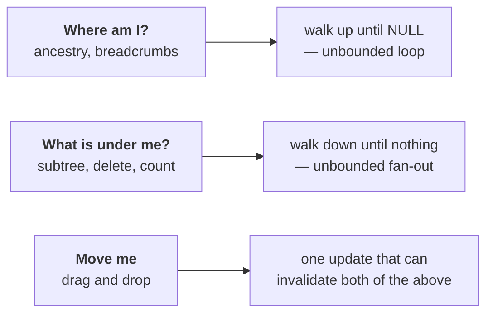

# Chapter 1 · Why hierarchies are hard

> Volume I · The Shape of Trees
> Written at M9, last of the twenty, on purpose · last verified 2026-11-19

A relational database stores sets of rows. A tree is not a set of rows; it is a set of rows
**plus a promise about the edges between them**, and the database will not keep that promise for
you.

That sentence is the whole difficulty, and everything in this book is a consequence of it.

---

## The promise nothing enforces

Here is the entire structure of the tree in this project:

```sql
parent_id BIGINT REFERENCES nodes(id) ON DELETE CASCADE   -- NULL means root
```

A foreign key guarantees exactly one thing: that `parent_id`, when it is not null, names a row
that exists. It does **not** guarantee that following `parent_id` repeatedly ever reaches a
root. It cannot. The constraint looks at one row at a time, and "this collection of edges forms
a tree" is a statement about all of them at once.

So:

```
Work  →  parent = Archive
Archive → parent = Work
```

Both rows satisfy every constraint in the schema. Both are perfectly valid. Together they are
not a tree — they are a cycle floating next to one, and **every query that walks up from either
one never terminates**.

> A tree in a relational store is an invariant, not a shape. It holds because code holds it, and
> it stops holding the moment a path exists that does not check.

---

## The three questions, and why each one is awkward

Every tree application asks the same three things, and SQL is differently unhelpful about each.



**Where am I** is a loop with no fixed bound. The number of steps is the depth, which is data,
not schema. Before `WITH RECURSIVE` this was N round trips and people wrote it in the
application; that is why so much tree code is a `while` loop with a database call in it.

**What is under me** is the same loop pointed the other way, and it fans out. "Delete this
folder" is not one row — it is an unknown number of rows discovered by traversal, and the
traversal has to happen somewhere: in the database as a cascade, in the ORM as N deletes, or in
the application as a bug.

**Move me** is one `UPDATE` of one column, and it is the dangerous one precisely because it
looks trivial. It can create a cycle. It can push a descendant past a depth limit without moving
that descendant. Two of them running at once can each be legal and produce something illegal
together. [Chapter 10](10-the-race-nobody-sees.md) is about that last one and it is the hardest
thing in this repository.

---

## Why it fails quietly

A SQL error is a good day. The tree failures in this project did not raise anything.

| What happened | What the user saw | What the database thought |
|---|---|---|
| A folder moved into its own descendant | the row vanished from the tree | every constraint satisfied |
| A folder deleted without a cascade | forty files appeared at the top level | `parent_id = NULL`, which is a valid root |
| A query walked an unbounded chain | a request that never came back | a connection doing exactly what it was told |

The second one is the clearest. In this schema `NULL` means *root*, so "detach this child" and
"promote this child to the top level" are **the same write**. An ORM that de-associates children
on delete — which is SQLAlchemy's default, and was the one line that caused it — is not
corrupting anything. It is doing something reasonable, into a schema where that reasonable thing
means something else entirely.

> **The expensive bugs here are not crashes.** They are writes that are valid, successful, and
> wrong, which is why none of them were noticed for eighteen months.

---

## What makes it hard is that each fix is cheap

Any one of these is a few lines:

- a recursive check before the move,
- `ON DELETE CASCADE`,
- a depth limit,
- an index on `parent_id`,
- a unique constraint on `(parent_id, name)`.

None is clever. The difficulty is not in writing them; it is in **knowing the list** — and then
in noticing that the obvious version of each one has a hole:

- the cycle check that runs before the lock is correct and useless ([Chapter 10](10-the-race-nobody-sees.md));
- the depth cap written as `depth(destination) + 1` ignores the height of the thing being moved
  ([Chapter 4](04-the-eight-invariants.md), I7);
- the cascade in the ORM does not hold for a `DELETE` typed into `psql`, and the one in the
  database does not keep the ORM's session consistent — you need both
  ([Chapter 6](06-the-orphans.md));
- the uniqueness constraint has to live on `(owner_id, parent_id, name)` or it is a cross-tenant
  bug waiting ([Chapter 12](12-identity-and-isolation.md)).

Each hole is one step past the obvious fix. That is the actual shape of this problem domain:
not deep theory, but a list of small things where the first answer is nearly right.

---

## What this book is

Twenty chapters about one folder tree, which is a small application by any measure. The reason
it is worth that many words is that the small application **shipped**, ran for seventeen months,
and was wrong in four ways that nobody noticed — and the record of how each was found, fixed and
then attacked again is more useful than the fix.

Volume II is forensics on code that shipped in April 2025. Volume III is how each failure is
actually fixed, including the cases where the obvious fix was incomplete. Volume IV is the
machinery — tests that can fail, containers, CI, and the two repositories becoming one. Volume V
is what to say about all of it out loud.

Every claim either quotes code anyone can clone, or names the test that proves it. Where
something turned out to be wrong, the correction sits in the same document at the same size as
the claim it replaces — [Chapter 8](08-the-register.md) ends with two of those, and they are the
most useful paragraphs in this book.

---

**Next:** [Chapter 2 · Four ways to store a tree](02-four-ways-to-store-a-tree.md)
