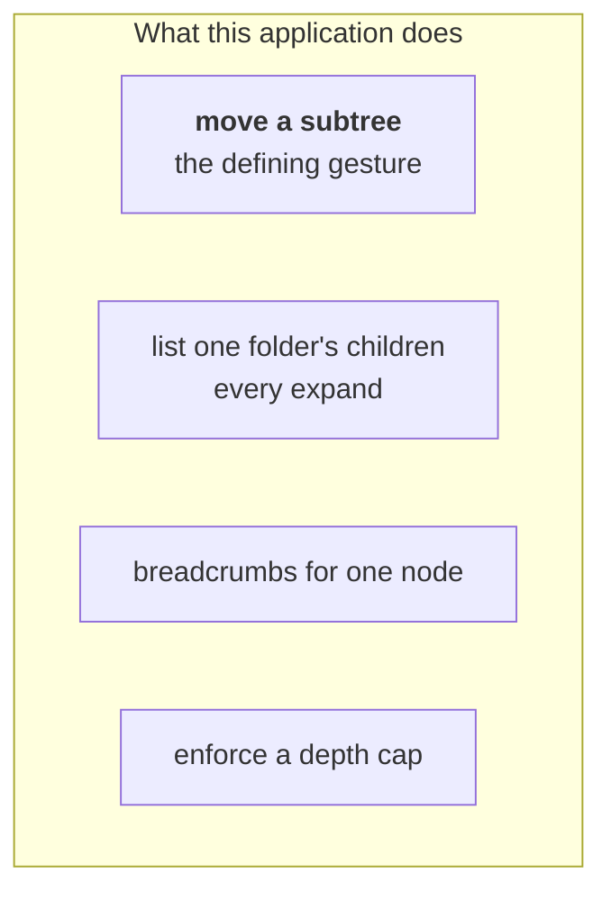

# Chapter 2 · Four ways to store a tree

> Volume I · The Shape of Trees
> Written at M9 · the decision is [ADR 0001](../adr/0001-adjacency-list.md) · last verified
> 2026-11-19

There are four standard ways to put a hierarchy in a relational table. Each one makes a
different operation cheap and a different operation expensive, and **the only way to choose is
to know which operation you will do most**.

For a drag-and-drop folder tree the dominant write is not insert and not delete. It is
**move** — and that single fact decides the whole question.

---

## The four

### 1. Adjacency list

Each row stores its parent.

```sql
CREATE TABLE nodes (
    id        BIGINT PRIMARY KEY,
    parent_id BIGINT REFERENCES nodes(id) ON DELETE CASCADE,  -- NULL means root
    name      TEXT NOT NULL
);
```

One self-referential foreign key, and the tree is implied by the edges. Moving a subtree is
**one row changing one column**: nothing below it moves, because nothing below it stores where
it is.

Reading an arbitrary subtree or an ancestry chain needs recursion. Before PostgreSQL 8.4 that
meant N round trips and it is the reason this layout had a bad reputation for a decade. Since
8.4 it is one `WITH RECURSIVE` statement, bounded by depth rather than by table size — which is
[Chapter 9](09-recursive-ctes.md).

### 2. Materialised path

Each row stores the full path to itself.

```
id  path                     name
 1  /                        root
 7  /1/                      Documents
19  /1/7/                    Invoices
```

Ancestry is a string operation and descendants are `LIKE '/1/7/%'`, which an index can serve.
Both reads are fast and neither needs recursion.

The cost is the move. Moving `Documents` rewrites **every descendant's path**, because every
descendant stores its own copy of the answer. Storage also grows with depth, and the encoding
has to survive ids that change length.

### 3. Nested sets

Each row stores a left and right number from a depth-first walk of the whole tree.

```
name        lft  rgt
root          1   12
  Documents   2    7
    Invoice   3    4
    Receipt   5    6
  Photos      8   11
    Beach     9   10
```

A subtree is `WHERE lft BETWEEN 2 AND 7` — one range scan, no recursion, and depth is free. It
is the fastest of the four to read.

It is also the slowest to write by a wide margin. Inserting or moving anything **renumbers a
large fraction of the table**, because the numbers encode position globally. Two concurrent
writers are a serialisation problem rather than a row-lock problem.

### 4. Closure table

A second table holds **every ancestor–descendant pair**, including each node with itself.

```
ancestor  descendant  depth
   1          1         0
   1          7         1
   1         19         2
   7         19         1
```

Ancestry and descendants are both a single indexed lookup with no recursion, and depth comes
back with the row. It is the right answer for read-heavy ancestry — permission checks, for
instance, millions of them.

The move cost is the whole subtree's worth of pairs: delete every pair joining the moved subtree
to its old ancestors, insert every pair joining it to its new ones. For a subtree of *n* nodes
at depth *d* that is on the order of *n × d* rows, inside a transaction, every time somebody
drags a folder.

---

## Costed against this workload



| | Move a subtree | Children of one folder | Ancestry | Depth check |
|---|---|---|---|---|
| **Adjacency list** | **1 row** | 1 indexed read | recursive CTE, bounded by depth | recursive CTE |
| Materialised path | rewrites every descendant | 1 indexed read | string split, no query | from the path, free |
| Nested sets | renumbers much of the table | range scan | range scan | free |
| Closure table | deletes and reinserts *n × d* pairs | 1 indexed read | 1 indexed read | free |

Every row of that table is a real trade. The reason the first column decides it here is that
**the first column is what a user does for fun**. Dragging folders around is the demo. Nobody
opens this application to run an ancestry query a million times.

> **ADR 0001, in one line:** adjacency list, because a move must be a single-row update and
> recursion is one statement rather than N round trips.

---

## What the choice costs, honestly

Choosing the adjacency list does not make the hard parts disappear. It moves them into one
place, and this project spends three chapters there.

- **A cycle becomes possible.** Nothing in the schema prevents a node being moved inside its own
  descendant; `parent_id` is just a foreign key. The guard is a recursive check inside the
  transaction that performs the move — [Chapter 5](05-the-cycle.md) — and it is the bug the
  April 2025 version shipped with.
- **Two concurrent moves can defeat a check that was correct when it ran.** Locking the ancestry
  chain in a deterministic order is [Chapter 10](10-the-race-nobody-sees.md), and it is the part
  that is genuinely difficult.
- **Depth has to be enforced rather than observed.** The cap is 64 and it is checked against the
  subtree's height plus the destination's depth, because a legal-looking move can push a
  *descendant* past the limit without the moved node itself breaking it.
- **Reads need a plan.** Unbounded recursion over somebody's whole tree is a denial of service
  waiting to be written; every recursive query here carries a depth bound and an owner
  predicate.

A closure table would have removed the recursion and added a consistency problem: two structures
describing one tree, and a trigger that must never be wrong. That is a reasonable trade when
reads dominate. It is the wrong trade when the thing people do is drag.

---

## When this stops being right

Honestly, and so the decision can be reopened by whoever needs to:

- **A read-heavy permission system** doing millions of ancestry checks against rare writes. The
  answer is to **add** a closure table maintained by trigger, as a derived index, keeping the
  adjacency list as the source of truth — not to replace it.
- **A tree that is effectively static** after creation, where move is a rare administrative
  action. Nested sets become reasonable, and the read speed is real.
- **A path that is itself meaningful to the user** — a filesystem, a URL hierarchy — where the
  materialised path is not a denormalisation but the actual identity of the thing.

None of those is this application.

---

**Next:** [Chapter 3 · The schema, line by line](03-the-schema.md)
