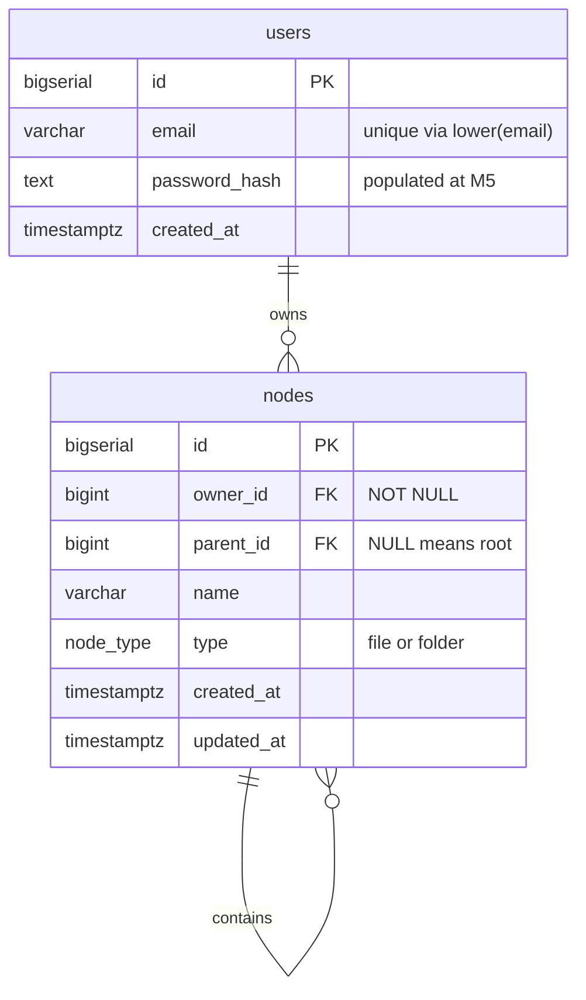

# Chapter 3 · The schema, line by line

> Volume I · The Shape of Trees
> Written at M2 · **built and verified in CI** · last verified 2026-11-14

Two tables. Every line earns its place, and several exist because of a specific bug.



The self-referential edge on `nodes` is the entire hierarchy. Everything difficult in this
project comes from that one line.

---

## The table

```sql
CREATE TYPE node_type AS ENUM ('file', 'folder');

CREATE TABLE nodes (
    id         BIGSERIAL PRIMARY KEY,
    owner_id   BIGINT       NOT NULL REFERENCES users(id) ON DELETE CASCADE,
    parent_id  BIGINT       NULL     REFERENCES nodes(id) ON DELETE CASCADE,
    name       VARCHAR(255) NOT NULL,
    type       node_type    NOT NULL,
    created_at TIMESTAMPTZ  NOT NULL DEFAULT now(),
    updated_at TIMESTAMPTZ  NOT NULL DEFAULT now(),

    CONSTRAINT ck_nodes_not_own_parent CHECK (parent_id IS DISTINCT FROM id),
    CONSTRAINT ck_nodes_name_not_blank CHECK (length(btrim(name, E' \t\n\r\f\v')) > 0),
    CONSTRAINT uq_nodes_id_owner       UNIQUE (id, owner_id),
    CONSTRAINT fk_nodes_parent_same_owner
        FOREIGN KEY (parent_id, owner_id) REFERENCES nodes (id, owner_id) ON DELETE CASCADE
);

CREATE INDEX idx_nodes_owner_parent ON nodes (owner_id, parent_id);
CREATE UNIQUE INDEX uq_nodes_parent_name ON nodes (parent_id, name) WHERE parent_id IS NOT NULL;
CREATE UNIQUE INDEX uq_nodes_root_name   ON nodes (owner_id, name) WHERE parent_id IS NULL;
```

---

## Five lines worth defending

### 1 · `IS DISTINCT FROM`, not `!=`

For a nullable column these are not the same. `parent_id != id` evaluates to `NULL` whenever
`parent_id` is `NULL`, and **a CHECK constraint passes on NULL** — so the constraint would
silently do nothing for every root node. `IS DISTINCT FROM` treats `NULL` as a value and returns
a real boolean.

This is the most common null-handling mistake in SQL constraints, and it fails in the quietest
possible way: the constraint exists, appears in `\d nodes`, and protects nothing.

> Proven by `test_self_parent_rejected`, which asserts both the service error *and* an
> `IntegrityError` when the constraint is attacked directly.

### 2 · Two partial unique indexes, not one constraint

In PostgreSQL, `NULL` values are **distinct from each other** for uniqueness purposes. A plain
`UNIQUE (parent_id, name)` therefore constrains nothing at the root: every root row has
`parent_id = NULL`, no two NULLs ever conflict, and you could create a thousand folders called
`Documents` at the top level.

Splitting into two partial indexes handles both cases explicitly — and the root one additionally
scopes by `owner_id`, which a single constraint could not express. PostgreSQL 15's
`UNIQUE NULLS NOT DISTINCT` would cover the first half; the root case still needs its own index.

> Proven by `test_root_names_unique_per_owner`, which also asserts the *same* root name is fine
> for two different people.

### 3 · `btrim(name, E' \t\n\r\f\v')`, not `btrim(name)`

**`btrim` with one argument trims spaces only.** The original version of this constraint read
`length(btrim(name)) > 0`, and a name consisting of a single tab character sailed through it —
so the bug it was written to fix was never actually fixed.

The explicit set covers ASCII whitespace. **Unicode whitespace is not covered** — a name
consisting of a single non-breaking space is storable today. Stripping and NFC-normalising
belongs with the create and rename endpoints, which do not exist yet; there is currently no write
path for a name at all. Recorded here rather than implied to be handled.

> Proven by `test_whitespace_only_names_rejected`, which tries space, tab, newline and CRLF.

### 4 · The composite foreign key

```sql
UNIQUE (id, owner_id)
FOREIGN KEY (parent_id, owner_id) REFERENCES nodes (id, owner_id) ON DELETE CASCADE
```

A plain `parent_id → id` foreign key constrains the id **and nothing else**. So a node could be
attached under a parent belonging to a different user — and then that user deleting their folder
would cascade straight into someone else's subtree. Silent cross-tenant destruction.

Referencing the `(id, owner_id)` pair makes a cross-owner parent a foreign-key violation,
whatever the application layer forgets. `MATCH SIMPLE` — the default — skips the check when any
column is `NULL`, which is exactly the behaviour a root node needs.

The `UNIQUE (id, owner_id)` is redundant against the primary key and exists only because a
foreign key needs a unique index on the columns it references. That is the price of the pattern,
and it is cheap.

> Proven by `test_composite_key_blocks_cross_owner_attach`, which **bypasses the service
> entirely** — the service checks ownership twice, so the test asserts the database would refuse
> even if both checks were deleted.

### 5 · `owner_id` first in the index

```sql
CREATE INDEX idx_nodes_owner_parent ON nodes (owner_id, parent_id);
```

Column order is deliberate. `owner_id` comes first because it is in *every* `WHERE` clause in
the application, and a composite index can serve a prefix of its columns — so this one index
covers both "everything owned by this user" and "the children of this folder". Reversed, it
would only help the second.

It is also what makes the recursive walks cheap: each step is one indexed lookup rather than a
scan, so ancestry costs scale with depth, not with table size.

---

## The principle underneath

> **Anything that must never be true goes in the database. Anything that needs a good error
> message goes in the application. Most things need both.**

The self-parent rule is the clearest case: it is a CHECK constraint *and* a service check. The
constraint makes the bad state impossible; the service makes it explainable.

---

**Next:** [Chapter 4 · The eight invariants](04-the-eight-invariants.md)
