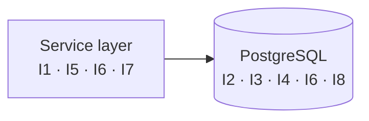

# Chapter 4 · The eight invariants

> Volume I · The Shape of Trees
> Written at M2 · **all eight have passing tests** · last verified 2026-11-14

An invariant is a statement that is true before an operation and true after it, whatever the
operation was. These eight define what "a valid tree" means here. Everything in Volume III
exists to keep one of them.

| # | Invariant | Enforced by | Test |
|---|---|---|---|
| **I1** | A node is never its own ancestor | Recursive CTE check inside a row-locked transaction | `test_move_into_direct_child_rejected`, `test_move_into_distant_descendant_rejected`, `test_concurrent_move_four_cycle` |
| **I2** | `parent_id IS NULL` means root, scoped per owner | `uq_nodes_root_name` | `test_root_names_unique_per_owner` |
| **I3** | Deleting a node deletes its whole subtree | `ON DELETE CASCADE` | `test_delete_cascades_whole_subtree` |
| **I4** | Sibling names are unique within a parent | `uq_nodes_parent_name` | `test_duplicate_sibling_name_returns_409` |
| **I5** | A file is always a leaf | Service layer | `test_cannot_move_into_a_file` |
| **I6** | Every node in a subtree shares one owner | Composite FK **and** the service | `test_cannot_move_another_users_node`, `test_composite_key_blocks_cross_owner_attach` |
| **I7** | Depth never exceeds 64 | Depth check on move, measuring subtree height | `test_depth_counts_subtree_height` |
| **I8** | A node's `id` never equals its `parent_id` | `ck_nodes_not_own_parent` | `test_self_parent_rejected` |

---

## Why number them

Because a numbered invariant can be cited from a test name, a commit message, a pull request and
a code comment, and all four then point at the same sentence. When someone asks *"what stops
this?"*, the answer is "I6, and here is `test_composite_key_blocks_cross_owner_attach`".

Unnumbered rules drift. Numbered rules get cited.

---

## Where each one actually lives



Note that **I6 appears twice**. That is not redundancy by accident — it is the one invariant
where the database backstop was added specifically because a review found the service could be
wrong about it. The service produces the 404; the composite foreign key makes the bad state
impossible regardless.

---

## I7 deserves a note

A depth cap looks arbitrary and is often left out. It should not be.

Without one, a script can create a chain of a hundred thousand nested folders in a few seconds
through the ordinary API. Nothing in the schema forbids it. Then the first recursive query over
that chain holds a connection open, allocates memory proportional to depth, and the service
falls over — using entirely legitimate requests.

**And the obvious implementation of the cap is wrong.** "Reject if the resulting depth exceeds
64" usually means `depth(destination) + 1`, which only knows about the destination. The real
bound is:

```
depth(destination) + 1 + height(subtree being moved)
```

Two legal 60-deep chains compose into a 120-deep tree in a single move, because the algorithm
never walked *downward* to see what it was carrying. The fix needs a descending walk as well as
an ascending one.

> `test_depth_counts_subtree_height` builds a chain occupying most of the budget and a short one
> that will not fit beneath it, then asserts the move is refused.

Sixty-four is chosen to sit far above any real use — the deepest folder anyone has genuinely
wanted is perhaps fifteen — and far below anything that threatens the database. The number
matters less than the fact that one exists.

---

## I7 is not really about depth

The chapter above argues I7 on denial-of-service grounds, and that argument stands. It is also
not the important one.

Both recursive walks are bounded at `max_depth` — they have to be, or a cycle in the data makes
the cycle detector the first casualty of the cycle it exists to detect. But a bounded walk does
not fail when the chain is longer than the bound. **It stops and returns what it has.**

So on a tree one level over the cap, `ancestry` returns a partial chain that is indistinguishable
from a complete one. Hand that to the cycle check and it misses an ancestor that is genuinely
there, answers "no cycle", and allows the move.

**I7 is what keeps I1 sound.** Lose the cap and the cycle check quietly starts failing open.

That changes where the cap has to be enforced. It is not enough to check it on `move`, which is
where it started: `create` has to check it too, and `create` has to take the measurement while
holding `FOR NO KEY UPDATE` on the parent's chain — otherwise a concurrent move deepens that
chain between the measurement and the insert, and the new node lands past the cap anyway. Full
argument in [chapter 9](09-recursive-ctes.md).

The walks also now report truncation rather than hiding it. `TreeTooDeep` is a 500 and is
deliberately a different error from `DepthExceeded`, which is the 409 for an operation that
*would* break I7. One says "you cannot do that"; the other says "this tree is already wrong and
I will not guess."

---

## The name rules, which are not invariants but belong here

Eight invariants describe the *shape* of the tree. None of them says anything about what a name
may contain, and the database check only guarantees a name is not blank once six ASCII whitespace
characters are trimmed. That leaves a surprising amount.

| What | Why it matters |
|---|---|
| `NUL` (U+0000) | PostgreSQL text cannot hold it. Without a check it surfaces as a driver `ValueError` from inside psycopg — not an `IntegrityError`, so `_translate` never sees it and it escapes as a 500. |
| C0, C1 and `DEL` | Break terminals and logs, and make a name that cannot be typed back. |
| Directional overrides and isolates | The Trojan Source set. They reorder how the rest of the string renders, so a name can display as `report.txt` and be something else. |
| Zero-width space, word joiner, BOM | Invisible in every font, so two different names look identical and a person cannot tell which they are clicking. |
| A name of one non-breaking space | Passes the database check, looks blank, sorts as though blank, and cannot be typed again. |
| `café` two ways | Precomposed and decomposed are different byte strings that render identically. Stored raw they become two siblings nobody can distinguish — and the unique index cannot help, because it compares stored bytes. |

The last one is why names are **NFC-normalised before storing**, in both write paths. Normalising
at the edge is what turns a look-alike into a 409.

### A list, then a rule

The first version of this enumerated three invisible characters. Review took about a minute to
find eight more walking straight past it: `U+00AD` SOFT HYPHEN, `U+180E`, `U+034F`, the four
Hangul fillers, and `U+2028`/`U+2029` in the middle of a name where `strip()` never looks. The
list had no stated selection rule, so the next one would have been another patch.

The rule is by Unicode general category instead — `Cc`, `Cf`, `Cs`, `Zl`, `Zp` — which covers the
whole class including characters not yet assigned. The Hangul fillers need an explicit entry
because they are category `Lo`: they are *letters* that render as nothing, so no category rule
reaches them.

### The deliberate holes

Five format characters are allowed back in, and saying why is the point:

- **ZWNJ (U+200C) and ZWJ (U+200D)** are the difference between two spellings in Persian, Arabic
  and several Indic scripts. They are orthography, not decoration.
- **LRM (U+200E), RLM (U+200F) and ALM (U+061C)** are *marks*: they give a neighbouring character
  a direction rather than reordering the string, which is what the override set does.
  Mixed-direction names need them.

Review listed ALM among the characters that should be blocked. It is allowed here, deliberately:
it is the Arabic counterpart of the two marks already allowed, and blocking it while permitting
LRM and RLM would be an arbitrary line drawn at the edge of one alphabet.

Each carve-out widens the attack surface slightly. The trade taken is that a name must be
*representable in the writer's own language*. A deny-list that makes ordinary Persian or Arabic
names impossible is not a safer system, only a narrower one.

### What is explicitly out of scope

The earlier version of this chapter claimed the deny-list covered "the spoofing that actually
matters". It did not, and the claim was too broad even for the corrected rule.

**Homoglyphs are not addressed.** `report.txt` with a Greek omicron (U+03BF) or a Cyrillic
small o (U+043E) renders
identically to the Latin one and passes every check here. So do visually similar spaces inside a
name. Catching those needs a confusable-skeleton check against the Unicode security data, which
is a different piece of work with real false-positive risk for multilingual names.

What *is* covered, stated narrowly: **look-alikes built from characters that render as nothing,
and names that reorder their own display.**

---

## The ceiling, which is a bound rather than an invariant

`MAX_NODES_PER_USER` stops one account filling the database. It is enforced in `create` rather
than by a constraint, because a counting constraint would have to serialise every insert for that
owner.

Two concurrent creates can both pass the check, so the ceiling is soft by the number of requests
in flight. That is stated rather than hidden: a hard ceiling costs a per-owner counter row that
every create must lock, which is a bad trade for a limit whose job is to stop scripts rather than
to bill anyone.

---

## What is not an invariant

Worth stating, because the absence is deliberate:

- **No "a folder must have a unique name globally".** Names are unique within a parent, and per
  owner at the root. That is all.
- **No "files must have an extension".** The type column distinguishes file from folder; the
  name is otherwise the user's business.
- **No soft delete.** Deletion is permanent. That is the most destructive operation in the
  system and it is irreversible, which is a known weakness rather than an oversight — see the
  change log.

---

**Next:** [Chapter 5 · The cycle](05-the-cycle.md)
