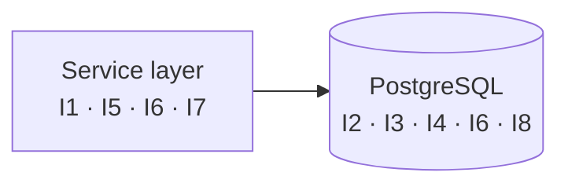

# Chapter 4 · The eight invariants

> Volume I · The Shape of Trees
> Written at M2 · **all eight have passing tests** · last verified 2026-11-14

An invariant is a statement that is true before an operation and true after it, whatever the
operation was. These eight define what "a valid tree" means here. Everything in Volume III
exists to keep one of them.

| # | Invariant | Enforced by | Test |
|---|---|---|---|
| **I1** | A node is never its own ancestor | Recursive CTE check inside a row-locked transaction | `test_move_into_direct_child_rejected`, `test_move_into_distant_descendant_rejected`, `test_concurrent_move_four_cycle` |
| **I2** | `parent_id IS NULL` means root, scoped per owner | `uq_nodes_root_name` | `test_root_names_unique_per_owner` |
| **I3** | Deleting a node deletes its whole subtree | `ON DELETE CASCADE` | `test_delete_cascades_whole_subtree` |
| **I4** | Sibling names are unique within a parent | `uq_nodes_parent_name` | `test_duplicate_sibling_name_returns_409` |
| **I5** | A file is always a leaf | Service layer | `test_cannot_move_into_a_file` |
| **I6** | Every node in a subtree shares one owner | Composite FK **and** the service | `test_cannot_move_another_users_node`, `test_composite_key_blocks_cross_owner_attach` |
| **I7** | Depth never exceeds 64 | Depth check on move, measuring subtree height | `test_depth_counts_subtree_height` |
| **I8** | A node's `id` never equals its `parent_id` | `ck_nodes_not_own_parent` | `test_self_parent_rejected` |

---

## Why number them

Because a numbered invariant can be cited from a test name, a commit message, a pull request and
a code comment, and all four then point at the same sentence. When someone asks *"what stops
this?"*, the answer is "I6, and here is `test_composite_key_blocks_cross_owner_attach`".

Unnumbered rules drift. Numbered rules get cited.

---

## Where each one actually lives



Note that **I6 appears twice**. That is not redundancy by accident — it is the one invariant
where the database backstop was added specifically because a review found the service could be
wrong about it. The service produces the 404; the composite foreign key makes the bad state
impossible regardless.

---

## I7 deserves a note

A depth cap looks arbitrary and is often left out. It should not be.

Without one, a script can create a chain of a hundred thousand nested folders in a few seconds
through the ordinary API. Nothing in the schema forbids it. Then the first recursive query over
that chain holds a connection open, allocates memory proportional to depth, and the service
falls over — using entirely legitimate requests.

**And the obvious implementation of the cap is wrong.** "Reject if the resulting depth exceeds
64" usually means `depth(destination) + 1`, which only knows about the destination. The real
bound is:

```
depth(destination) + 1 + height(subtree being moved)
```

Two legal 60-deep chains compose into a 120-deep tree in a single move, because the algorithm
never walked *downward* to see what it was carrying. The fix needs a descending walk as well as
an ascending one.

> `test_depth_counts_subtree_height` builds a chain occupying most of the budget and a short one
> that will not fit beneath it, then asserts the move is refused.

Sixty-four is chosen to sit far above any real use — the deepest folder anyone has genuinely
wanted is perhaps fifteen — and far below anything that threatens the database. The number
matters less than the fact that one exists.

---

## What is not an invariant

Worth stating, because the absence is deliberate:

- **No "a folder must have a unique name globally".** Names are unique within a parent, and per
  owner at the root. That is all.
- **No "files must have an extension".** The type column distinguishes file from folder; the
  name is otherwise the user's business.
- **No soft delete.** Deletion is permanent. That is the most destructive operation in the
  system and it is irreversible, which is a known weakness rather than an oversight — see the
  change log.

---

**Next:** [Chapter 5 · The cycle](05-the-cycle.md)
