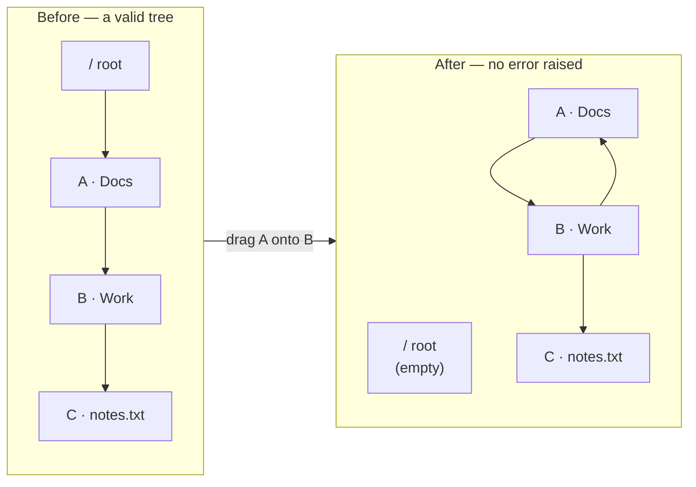

# Chapter 5 · The cycle

> Volume II · What Went Wrong
> Written at M2 · **fixed and tested** · last verified 2026-11-14

Eight lines of Python that look complete and are not. This is the project's defining bug.

## What shipped in April 2025

```python
@app.route('/api/move/<int:id>', methods=['PATCH'])
def move_node(id):
    node = Node.query.get_or_404(id)
    new_parent_id = request.json.get('new_parent_id')

    if new_parent_id == id:                                   # <- the only check
        return jsonify({"error": "Cannot move into itself"}), 400

    node.parent_id = new_parent_id
    db.session.commit()
```

That check is correct. It is also one case out of an unbounded number: it catches *A into A*,
and misses *A into a child of A*, *A into a grandchild*, and every depth beyond.

The reason is structural. The check compares two integers the request supplied. The illegal
condition is a property of **the path between them**, which lives in rows the request never
mentions. You cannot detect it without querying.

## What it does



Three rows still exist. All are individually valid — correct types, satisfied foreign keys,
nothing a CHECK constraint would catch. None is reachable from the root.

Note that `C · notes.txt` was never touched by the request and is nonetheless gone from the
user's view. **Damage from a cycle is always larger than the rows involved in the move.**

> A cycle is not data corruption. It is a **reachability failure** — valid rows that no longer
> form a tree. That is why no amount of per-row validation catches it.

## Why the interface did not stop it either

The tree library ships with its own descendant check. The frontend overrode it:

```javascript
canDrop={(tree, { dragSource, dropTargetId }) => {
  const target = tree.find(n => n.id === dropTargetId);
  return target?.droppable;          // true for ANY folder
}}
```

Providing a custom `canDrop` that returns a non-undefined value replaces the library's built-in
behaviour rather than adding to it. So the server had no check worth the name, and the client
had just disabled the one it was given.

> **Still unverified.** That describes the library's documented behaviour; it has not been
> demonstrated against this code. It is resolved at M6 by running the drag and watching. Until
> then the server check is treated as the only one that exists — which is the correct posture
> regardless, because a client guard is a convenience and never a control.

## The fix

```python
if self._repo.is_ancestor_of(actor_id, node_id, new_parent_id):
    raise CycleDetected
```

One recursive query, any depth. [Chapter 9](09-recursive-ctes.md) covers how it works.

> `test_move_into_direct_child_rejected` covers one level down — the case the original allowed.
> `test_move_into_distant_descendant_rejected` builds six levels and moves the root of the chain
> onto its deepest leaf, which a single-level check would miss.

**And it is still not enough.** Two concurrent moves can each pass that check against a tree
that is still valid at the moment they look. [Chapter 10](10-the-race-nobody-sees.md) is about
why, and it is the most interesting thing in the project.

## What generalises

A client-side guard improves the experience by refusing an action before the round trip. It is
never a control, because the client is under the user's control — the same request goes out with
`curl`. Here the guard was *also* broken, but a perfect one would not have made the server
correct.

---

**Next:** [Chapter 6 · The orphans](06-the-orphans.md)
