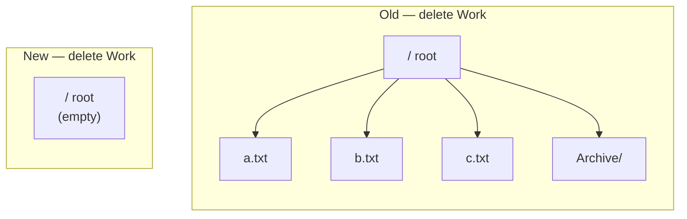

# Chapter 6 · The orphans

> Volume II · What Went Wrong
> Written at M2 · **fixed and tested** · last verified 2026-11-21

One line with a default nobody reads. Deleting a folder did not delete what was inside it — it
emptied the contents onto the root.

## What shipped

```python
children = db.relationship('Node',
    backref=db.backref('parent', remote_side=[id]))
    # no cascade argument -> SQLAlchemy default: "save-update, merge"
```

With that default, deleting a parent does not delete its children. SQLAlchemy **de-associates**
them: it issues `UPDATE nodes SET parent_id = NULL` for each one.

And in this schema `parent_id = NULL` does not mean orphaned. It means **root**.



Deleting a folder containing forty files moved all forty to the top level, with no warning and
no error. The user, who intended to delete forty files, instead got forty files dumped in their
root directory. There was no confirmation dialog either, so a single misplaced click did it.

> This is the worst kind of bug: **it looks like it worked.**

## The fix, in two places

```python
# database -- the guarantee. Holds for a manual DELETE in psql.
parent_id BIGINT REFERENCES nodes(id) ON DELETE CASCADE

# ORM -- so the session's identity map stays consistent in-request
children = relationship(
    "Node",
    foreign_keys=[parent_id],
    cascade="save-update, merge",
    passive_deletes=True,
)
```

`passive_deletes=True` is the detail worth knowing. Without it SQLAlchemy loads every descendant
into memory to delete them one at a time — correct, but it turns deleting a large folder into
thousands of statements. With it, the ORM trusts the database's cascade and issues one.

> `test_delete_cascades_whole_subtree` builds four levels, deletes the top, and asserts **zero**
> rows remain.

## The second bug, found before it shipped

The obvious ORM spelling of the fix is `cascade="all, delete-orphan"`. That is what was written
first, and a review caught it.

**`delete-orphan` deletes a child on de-association.** And moving a node to the root *is*
de-association — `node.parent = None`. So the ORM emits a `DELETE`, and `passive_deletes=True`
then lets PostgreSQL's cascade take the whole subtree.

The feature that destroys is **move-to-root**, which is precisely the bug the frontend rebuild
exists to fix.

### It only fires on some paths, and that matters

The first test written for this passed with the bug reintroduced. Probing three paths with
`delete-orphan` restored gave:

| How the child is detached | Result |
|---|---|
| `child.parent = None`, parent's collection never loaded | row **kept** |
| `child.parent = None`, parent's collection loaded | row **DELETED** |
| `parent.children.remove(child)` | row **DELETED** |

SQLAlchemy needs the parent's collection in the session to recognise the orphan. A test that
detaches on a cold session therefore proves nothing — and that is what the first version did.

Those two dangerous paths are the normal case for any code that walks the tree through the ORM,
so the risk is real; it simply is not reachable from *every* spelling of the operation.

> `test_orm_de_association_does_not_delete` loads the collection first, asserts it contains the
> child, then detaches — and the assertion on that load is load-bearing, not decoration.

## Deleting, and the number you report

The cascade is what makes `delete` more than one statement. `DELETE FROM nodes WHERE id = :id`
removes an arbitrary number of rows, and the API wants to say how many. Two things fall out of
that, and the second is where a test of mine turned out to prove nothing.

**The count has to come first.** `rowcount` sees only the row the statement named — the cascade is
invisible to it — and afterwards there is nothing left to count. So the subtree is counted, then
deleted.

**The count has to be taken under the lock.** Otherwise a create that is already in flight beneath
the doomed node gets destroyed by the cascade without ever being counted, and the caller is told a
number that is smaller than what was actually removed.

```
lock, then count                      count, then lock
----------------                      ----------------
delete blocks on the lock             count is a plain read: 2
create commits (3 nodes)              delete blocks on the DELETE
delete wakes, counts 3                create commits (3 nodes)
removes 3, reports 3     ✓            wakes, cascade removes 3, reports 2   ✗
```

One row is enough to lock. `create` locks its parent's **entire** ancestry, so a create anywhere
beneath this node already conflicts with a lock on the node itself. A move *out* of the subtree is
the case this does not serialise — it locks the node it moves and the destination chain, neither of
which need include the doomed node — and the code says so in a comment rather than implying a
guarantee it does not have. Locking every row in the subtree is exactly the cost the design avoids.

### The test that proved nothing, again

The first version asserted that a create beneath the doomed node blocks while that node is locked.
It did this by calling `lock_one` directly. It passed with the lock removed from `delete`
altogether, because it never went through `delete` at all — it tested that PostgreSQL's row locks
work, which was not in doubt.

Mutation testing caught it: the whole suite stayed green with the lock deleted.

> This is the **third** test in this project that could not fail for its stated reason. The other
> two are in [chapter 6 above](#it-only-fires-on-some-paths-and-that-matters) and chapter 10. The
> pattern is the same every time — the test reaches past the thing it is testing and asserts
> something about a lower layer instead.

What fixes it is finding an observable that differs between the two orderings. Both block. Both
end with an empty table. The only thing that differs is **the number `delete` returns**, so that
is what the test asserts:

```python
assert reported["count"] == 3, (
    f"delete reported {reported['count']} nodes but removed 3 — it counted the "
    "subtree before taking its lock, so a create that was in flight was "
    "destroyed without ever being counted"
)
```

Re-run against the same mutation, it fails with `delete reported 2 nodes but removed 3` — the exact
number the docstring predicts.

### `57014`, which is why this needed handling at all

A cascading delete of a large subtree can exceed `statement_timeout`, having already held locks on
every row for the whole budget. It is mapped to 503 and deliberately **not** retried: the second
attempt spends the same budget and fails the same way. See
[chapter 10](10-the-race-nobody-sees.md) for the full table of sqlstates.

## The general shape

Every ORM has a delete-behaviour default, and in most of them the default is not what a beginner
expects:

| | Default | Surprise |
|---|---|---|
| SQLAlchemy | `save-update, merge` | children are de-associated, not deleted |
| Django | `CASCADE` | deleting a user silently removes everything they created |
| Rails | nothing | rows left pointing at a parent that no longer exists |

There is no safe default. That is why *"every foreign key gets an explicit `ondelete`"* is a
rule in `CONTRIBUTING.md` rather than a preference.

---

**Next:** [Chapter 7 · The silent outage](07-the-silent-outage.md)
