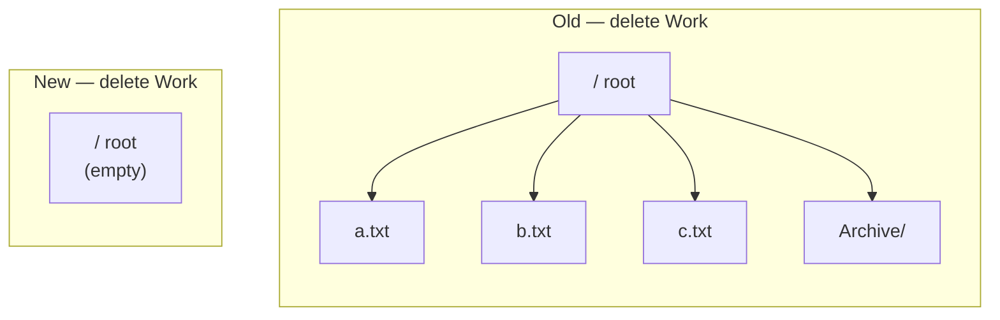

# Chapter 6 · The orphans

> Volume II · What Went Wrong
> Written at M2 · **fixed and tested** · last verified 2026-11-14

One line with a default nobody reads. Deleting a folder did not delete what was inside it — it
emptied the contents onto the root.

## What shipped

```python
children = db.relationship('Node',
    backref=db.backref('parent', remote_side=[id]))
    # no cascade argument -> SQLAlchemy default: "save-update, merge"
```

With that default, deleting a parent does not delete its children. SQLAlchemy **de-associates**
them: it issues `UPDATE nodes SET parent_id = NULL` for each one.

And in this schema `parent_id = NULL` does not mean orphaned. It means **root**.



Deleting a folder containing forty files moved all forty to the top level, with no warning and
no error. The user, who intended to delete forty files, instead got forty files dumped in their
root directory. There was no confirmation dialog either, so a single misplaced click did it.

> This is the worst kind of bug: **it looks like it worked.**

## The fix, in two places

```python
# database -- the guarantee. Holds for a manual DELETE in psql.
parent_id BIGINT REFERENCES nodes(id) ON DELETE CASCADE

# ORM -- so the session's identity map stays consistent in-request
children = relationship(
    "Node",
    foreign_keys=[parent_id],
    cascade="save-update, merge",
    passive_deletes=True,
)
```

`passive_deletes=True` is the detail worth knowing. Without it SQLAlchemy loads every descendant
into memory to delete them one at a time — correct, but it turns deleting a large folder into
thousands of statements. With it, the ORM trusts the database's cascade and issues one.

> `test_delete_cascades_whole_subtree` builds four levels, deletes the top, and asserts **zero**
> rows remain.

## The second bug, found before it shipped

The obvious ORM spelling of the fix is `cascade="all, delete-orphan"`. That is what was written
first, and a review caught it.

**`delete-orphan` deletes a child on de-association.** And moving a node to the root *is*
de-association — `node.parent = None`. So the ORM would emit a `DELETE`, and because
`passive_deletes=True` means children are never loaded, PostgreSQL's cascade would take the
whole subtree.

The feature that destroys is **move-to-root**, which is precisely the bug the frontend rebuild
exists to fix.

And it hides perfectly: reparenting between two *loaded* parents is unaffected, so **every
A-into-B test passes**. Only a move-to-root test catches it.

> `test_move_to_root_does_not_delete_subtree` builds a three-node chain, moves the middle node
> to the root, and asserts all three rows survive and the grandchild still points at its parent.

## The general shape

Every ORM has a delete-behaviour default, and in most of them the default is not what a beginner
expects:

| | Default | Surprise |
|---|---|---|
| SQLAlchemy | `save-update, merge` | children are de-associated, not deleted |
| Django | `CASCADE` | deleting a user silently removes everything they created |
| Rails | nothing | rows left pointing at a parent that no longer exists |

There is no safe default. That is why *"every foreign key gets an explicit `ondelete`"* is a
rule in `CONTRIBUTING.md` rather than a preference.

---

**Next:** [Chapter 9 · Recursive CTEs](09-recursive-ctes.md)
