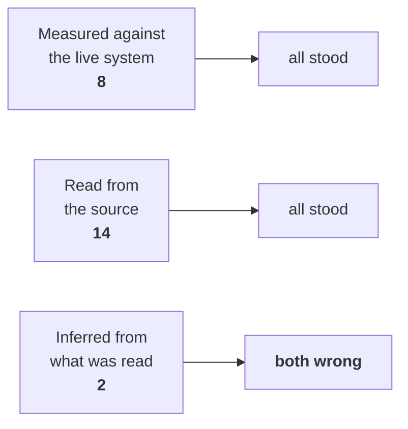

# Chapter 8 · The register

> Volume II · What Went Wrong
> Written at M9 · **all twenty-four closed** · last verified 2026-11-19

Twenty-four findings came out of the audit of the April 2025 code. This chapter is the register
itself, and then the part that matters more than the list: **how each one was obtained**, and
which kinds turned out to be wrong.

---

## The register

Grouped by what they threaten rather than by where they live, because that is the order a
reviewer cares about.

### Data integrity — the tree stops describing a tree

| # | Finding | Closed by |
|---|---|---|
| F-02 | `move_node` rejected only `new_parent_id == id`. **No descendant check**, so a folder could be moved inside itself and the subtree left the tree | M2 · `test_moving_a_folder_into_its_own_descendant_returns_409`, `test_move_into_distant_descendant_rejected` |
| F-03 | The ORM relationship declared no cascade, so deleting a folder issued `UPDATE nodes SET parent_id = NULL` for each child — and `NULL` means *root* | M2 · `test_delete_cascades_whole_subtree` |
| F-16 | No index on `parent_id`, and **no unique constraint on `(parent_id, name)`** | M2 · `test_duplicate_root_name_is_rejected` |
| F-13 | Inline `contentEditable` sent raw `textContent` on blur: no trim, no length cap, no validation on either side | M3a · name rules, with the duplicate response deliberately not echoing the name |

### Isolation and security — somebody else's rows

| # | Finding | Closed by |
|---|---|---|
| F-08 | `get_tree` called `Node.query.all()` — every row in the table, for every caller, with no scoping and no pagination | M5 · `test_a_listing_stops_at_the_owner_boundary`, `test_a_session_only_ever_sees_its_own_owners_tree` |
| F-04 | `GET /create-tables` was **unauthenticated** and called `db.create_all()` | M3b · the route is gone; schema changes are migrations |
| F-05 | CORS reflected any origin. Sending `Origin: https://evil.example.com` came back with `access-control-allow-origin: https://evil.example.com` | M5 · no CORS header is sent at all now, because D-22 made both halves same-origin |
| F-07 | `data['name']` raised `KeyError` on a missing field, so a malformed request was a 500. There was no error contract anywhere | M3b · every 4xx is an RFC 9457 problem document |

### Operations — it was not running

| # | Finding | Closed by |
|---|---|---|
| F-01 | `GET /api/tree` returned **HTTP 500** in under half a second. Cause confirmed from the logs: the API could not resolve its database host — the instance had been deleted | M7 · a new database, and a health check that fails when it is unreachable |
| F-24 | `GET /` returned a hardcoded string and never touched the database. **It could not fail while the process was alive**, so seventeen months of green uptime meant nothing | M3b · `test_health_executes_a_query_rather_than_returning_a_constant`, `test_health_reports_degraded_when_the_database_is_unreachable` |
| F-18 | A **52-second** cold start on the free tier, with nothing in the interface that said so | M8 · the client waits it out and says what it is waiting for |
| F-23 | No `Procfile`, `render.yaml`, `Dockerfile`, `runtime.txt` or `vercel.json` in either repository. The deployment existed only as settings in two dashboards | M7 · `render.yaml` and `vercel.json`, both committed |
| F-17 | `PyMySQL==1.1.1` pinned in a PostgreSQL project, with a commented-out MySQL connection string still in the source | M1 · the dependency is gone |

### The interface

| # | Finding | Closed by |
|---|---|---|
| F-06 | `handleDrop` looked the drop target up by id and returned early when it found nothing. **The root has no id**, so dragging anything back out to the top level did nothing at all, silently, for eighteen months | M6 · the client translates the library's root id to `null`; M8 · and the target finally had pixels (F-62) |
| F-14 | The delete button called `deleteNode` directly. No confirmation, and with F-03 above, one click scattered a folder's contents to the root | M6 · a confirmation that counts what is inside, and says so when it cannot |
| F-15 | `FolderNode.jsx` and `FileNode.jsx` were never imported; `rootId` was set and never read; `selectedId` was permanently `null` with its setter commented out | M6 · the rebuild has no dead files |
| F-11 | The API base URL was hardcoded to a Render hostname, with no environment variable | M6 · every URL is relative, enforced by a throw |
| F-12 | The only test was Create React App's default `renders learn react link`, and `App.js` contained no such text — **so the one test in the repository failed** | M6 · 67 web tests and 9 in a browser |
| F-22 | `react-scripts@5.0.1` — Create React App, deprecated and unmaintained | M6 · Vite 7, React 19, TypeScript 5 |

### The repository itself

| # | Finding | Closed by |
|---|---|---|
| F-09 | A committed virtualenv at `backend/bin/` and `backend/lib/python3.12/site-packages/`, and **no `.gitignore` at all**. The repository was 11,758 KB | M1 · history rewritten with `git filter-repo`, history preserved |
| F-19 | The frontend README contained the literal string `Material-UI (or any other UI library you're using)`, and MUI was not a dependency. The backend README ended mid-instruction inside an unclosed code fence | M7 · a README with a live link in the first paragraph |
| F-20 | 32 commits across both repositories, every one titled `Update N <file>` or `Create <file>`. One branch each. **Zero pull requests** | M1 onwards · and the first pull request opened by hand came on 19 November 2026 |
| F-21 | Neither repository had a licence | M0 · MIT |
| F-10 | The drag library's `canDrop` was passed a callback returning `dropTarget?.droppable`, which replaced **four** of the library's own rules rather than adding one | M6 · there is no `canDrop` prop, and the reason is in the component's docblock |

---

## Where the findings came from, and which kind was wrong

Each finding arrived in one of three ways, and the proportion is the interesting part.

**The eight measured findings** came from `curl` against the deployed API and the deployed site:
a 500 with a timing, a 52-second cold start, a reflected CORS header, a repository size. Nothing
about them depended on reading code correctly.

**The fourteen read findings** came from the source: a missing cascade argument, a route that
calls `db.create_all()`, a lookup that returns early. These are checkable by anyone with the
repository, and all fourteen survived.

**The two inferred findings are the ones that were wrong**, and both are recorded as corrections
rather than quietly dropped:

> **C-01 — "the app runs with `debug=True` in production."** The line is real. It is also inside
> `if __name__ == "__main__":`, and Render serves the application through gunicorn, which
> *imports* the module rather than running it as `__main__`. The block never executed in
> production. The debugger was never exposed.
>
> It was still the wrong local default and it was still removed. But "debug mode enabled in
> production" is a sentence that must not appear anywhere, because it is false.

> **C-02 — "the `/api/*` rewrite is live and D-22 is verified end to end."** Evidence: the health
> endpoint through the frontend domain returned `200`. It did. With
> `content-type: text/html` and a body of `index.html` — the single-page-app fallback, where
> *every* unmatched path answers 200. The command used was
> `curl -s -o /dev/null -w '%{http_code}'`, which **discards the response**.
>
> Two explanations fitted the number and the hoped-for one went into the record. It stood for a
> day.

The pattern is not subtle. **Of twenty-six claims, the two that were wrong were the two that
nobody measured in a way that could distinguish between explanations.** A finding read from
source is checkable. A finding measured against a running system is reproducible. A finding
inferred from either is a hypothesis wearing a finding's clothes.

---

## What a register is worth

A register is a credibility instrument, and its value is set by its **weakest** entry, not its
best. One finding that turns out to be wrong makes a reader re-examine the other twenty-three —
correctly, because they have no way to tell which kind each one is unless the document says.

So this one says. Every entry above is either a quotation of code in a repository anyone can
clone, or an observation with the command that produced it. The two that were neither are
printed above with their corrections attached, in the same document, at the same size.

> **The useful question to ask of any audit, including this one: for each finding, what would
> have to be true for it to be wrong, and did anybody check that?**

---

**Next:** [Chapter 9 · Recursive CTEs](09-recursive-ctes.md)
