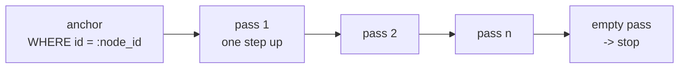
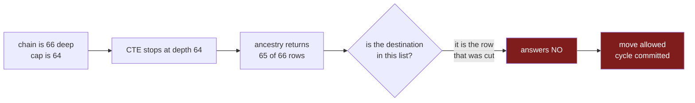

# Chapter 9 · Recursive CTEs

> Volume III · The Rebuild
> Written at M2, extended at M3a · **built and tested** · last verified 2026-11-21

The tool that makes an adjacency list practical: a single SQL statement that walks a chain of
unknown length.

## How it works

A recursive common table expression has two halves joined by `UNION ALL`. The first is the
**anchor** — the starting row. The second is the **recursive term**, which joins the table back
to the CTE itself. PostgreSQL runs the anchor once, then runs the recursive term repeatedly,
each pass fed only the rows the previous pass produced, until a pass produces nothing.

```sql
WITH RECURSIVE ancestry AS (
    -- anchor
    SELECT id, parent_id, name, type, 0 AS depth
      FROM nodes
     WHERE id = :node_id
       AND owner_id = :owner_id
    UNION ALL
    -- recursive term: one step up, repeated
    SELECT n.id, n.parent_id, n.name, n.type, a.depth + 1
      FROM nodes n
      JOIN ancestry a ON n.id = a.parent_id
     WHERE n.owner_id = :owner_id          -- I6
       AND a.depth < :max_depth            -- I7
)
SELECT id, parent_id, name, type, depth FROM ancestry ORDER BY depth
```

## Watching it run

For `root → Docs → Work → notes.txt`, starting at `notes.txt`:

| Pass | Working set in | Rows produced | Accumulated |
|---|---|---|---|
| anchor | — | notes.txt (depth 0) | notes.txt |
| 1 | notes.txt | Work (depth 1) | notes.txt, Work |
| 2 | Work | Docs (depth 2) | …, Docs |
| 3 | Docs | root (depth 3) | …, root |
| 4 | root | none — `parent_id` is NULL | stop |

Four index lookups, one round trip, one statement.

The naive alternative is a loop in Python issuing one query per level — four round trips here,
fifteen on a deep tree, each paying full network latency. On a database with 20 ms round-trip
time that is the difference between 25 ms and 300 ms for the same answer.



## Two predicates that are not optional

### The owner filter goes in the recursive term, not just the anchor

This is the one that bites. Filtering only the anchor looks sufficient — the walk starts at a
node you own, so surely it stays in your tree?

It does not. Attach a node under a foreign folder and the walk climbs straight out: the
ownership check on the *starting* node passes, and the response then carries **a stranger's
folder names**. Breadcrumbs become a read primitive against someone else's tree.

> `test_path_does_not_cross_owner` asserts both halves — that a foreign node's path is a 404,
> and that a legitimate path contains only the caller's own names.

### The depth bound

The CTE is `UNION ALL`, which does not deduplicate. On cyclic data an unbounded walk allocates
until it exhausts memory or hits a timeout — and **the cycle detector would be the first
casualty of the cycle it exists to detect.**

`a.depth < :max_depth` makes that impossible. PostgreSQL 14+ also offers a `CYCLE` clause; the
depth bound is used here because it doubles as the I7 enforcement the application needs anyway.

### The bound cuts both ways, and that is the dangerous part

A bound stops the runaway walk. It also means **a walk can return a wrong answer instead of an
error**, and that turns out to matter more.

`a.depth < :max_depth` does not fail when the chain is longer than the bound. It stops and returns
what it has. So on a tree one level over the cap, `ancestry` hands back a *partial* chain that is
indistinguishable from a complete one — same shape, same types, no warning. Feed that to the cycle
check and it misses an ancestor that is genuinely there, answers "no cycle", and allows the move.

The walk built to protect the cycle detector is the thing that defeats it.



This is why the depth cap is not really an I7 feature. I7 is the visible reason — a tree with no
limit is a denial-of-service vector. The load-bearing reason is **I1**: the cycle check is only
sound while every chain fits inside the walk.

Two things follow, and the code does both.

**The cap is enforced on `create`, under a lock.** Measuring the parent's depth without holding its
chain is a time-of-check-to-time-of-use bug: a concurrent move can re-parent an ancestor between the
measurement and the insert, and the new node lands past the cap. So `create` takes
`FOR NO KEY UPDATE` on the parent's chain and then measures as a fresh statement — the same two-step
discipline, and for the same reason, as [chapter 10](10-the-race-nobody-sees.md).

**The walks report truncation instead of hiding it.** A legal node sits at level `max_depth` or
less, so its ancestry is at most `max_depth` rows; the recursive term can emit one row past the
bound. More than `max_depth` rows therefore means the data already breaks I7:

```python
if len(rows) > self._max_depth:
    log.error("ancestry walk hit its depth bound; stored data breaks I7", ...)
    raise TreeTooDeep
```

`TreeTooDeep` is a 500, deliberately — distinct from `DepthExceeded`, which is the 409 for an
operation that *would* break I7. One says "you cannot do that"; the other says "this tree is
already wrong and I will not guess." A migration, a manual fix, or a cap that was raised and later
lowered all produce exactly this state.

> `test_a_chain_may_reach_the_cap_but_not_pass_it` runs against a `max_depth` of 4 rather than 64,
> so the whole boundary fits in one test — four levels allowed, the fifth rejected. A cap tested
> only well inside its limit can be off by one forever.
>
> `test_an_over_deep_chain_is_detected_not_silently_truncated` builds the illegal state with raw
> inserts, because that is how it actually arrives. Both were checked by mutation: an off-by-one in
> the cap and a removed truncation guard each turn exactly one of them red.

## Using it to prevent a cycle

The cycle check is the same walk, asked as a question. Before moving node X under parent P, walk
upward *from P* and ask whether X appears:

```sql
SELECT EXISTS (SELECT 1 FROM ancestry WHERE id = :candidate_id)
```

Moving X under its own descendant means X is somewhere on the path from that descendant up to
the root. That is precisely what this returns. One query, any depth, no loop.

## Listing is the fourth shape, and it is not recursive

`list_children` and `list_roots` are flat queries, which makes them look like the easy ones. They
carry the subtlest failure in this chapter.

Pagination is **keyset**, not `OFFSET`. `OFFSET 500` makes PostgreSQL walk and discard five
hundred rows before returning anything, so deep pages get linearly slower; worse, a row inserted
before the window shifts everything along and the next page silently skips one. The cursor is the
sort key itself — `(name, id)` — so neither happens:

```sql
WHERE owner_id = :owner_id
  AND parent_id = :parent_id
  AND (name COLLATE "C", id) > (:after_name COLLATE "C", :after_id)
ORDER BY name COLLATE "C", id
LIMIT :limit
```

### The collation is load-bearing

Keyset works only while the stored order and the comparison agree. A text index built under one
collation and compared under another disagrees with itself — which is exactly what the glibc 2.28
change did to indexes built before it.

Here that lands twice, because `uq_nodes_parent_name` and `uq_nodes_root_name` enforce I4 and I2
**and** carry the keyset ordering. A collation shift would let duplicates through and start
skipping pages at the same time, and neither failure announces itself.

Migration 0002 rebuilds both under `COLLATE "C"`: byte order, no locale, no library version to
drift with. The cost is `Zebra` before `apple`, which is a display concern and belongs to the
client. What pagination and uniqueness need is only that the order is *stable*.

> <del>Recreating a unique index under `"C"` cannot fail on existing data. The default
> collations are deterministic, so they already treat two different byte strings as unequal;
> `"C"` makes no more pairs equal than they were. It can only be more permissive, never
> less.</del>
>
> **Withdrawn 15 November, and the correction sat in the change log for six days before it
> reached this paragraph.** The argument above is about *which pairs compare equal*, and that
> part is sound. It is not what makes a `CREATE UNIQUE INDEX` fail. A **non-deterministic**
> collation — ICU with `deterministic = false`, which is exactly what a database restored from
> a locale-collated cluster can carry — treats canonically equivalent strings as equal, so two
> rows that were distinct under the old index collide under the new one and the migration
> aborts on precisely the databases this migration exists for. Migration 0002 now **looks for
> duplicates first and names them** rather than discovering them mid-rebuild.
>
> Worth more than the fix: the claim was wrong *and recorded as corrected*, and the chapter
> went on asserting it anyway. The book's rule is that corrections are appended rather than
> edited — which is a rule about the change log, and the change log kept it. Nothing connected
> the log to the prose it corrected.

### Why the test reads the catalogue instead of comparing sort orders

The obvious test inserts names and asserts byte order. It would have proved nothing.

**This suite's PostgreSQL is initialised with `--locale=C`**, so the database default already *is*
byte order — an ordering test passes whether or not the collation was ever pinned. Production is
not initialised that way, which is precisely where the bug would live.

So the guard reads `pg_index`, which records the collation each index was actually built with and
does not care what the default is:

```python
assert pinned[index] == "C", (
    f"{index} is built under collation {pinned[index]!r}, not 'C'. "
    "A glibc or ICU upgrade can then reorder it underneath the keyset "
    "comparison, and pages start skipping rows silently."
)
```

Confirmed by mutation: with the pin removed from the migration, the ordering test **still passed**
and only the catalogue test failed. A second test builds an ICU collation and asserts the two
orders genuinely *differ* on its data — a comparison that cannot tell its two sides apart is not a
comparison.

> The general lesson, and the third time this project has met it: **a test environment configured
> for convenience can hide the exact class of bug you are testing for.** `--locale=C` makes the
> suite deterministic, which is good, and makes one whole category of collation bug invisible,
> which is not.

### Two smaller things that are easy to get wrong

**One row beyond the page is fetched.** A page being full is not evidence that another page
exists. Without the lookahead, every list whose size divides evenly by the page size ends with a
cursor pointing at an empty page.

**The first-page sentinel is `('', 0)`**, and it is sound rather than lucky: `ck_nodes_name_not_blank`
means no stored name can be empty, so the sentinel sorts strictly below every real `(name, id)`.
That lets one statement serve the first page and every page after it, instead of two plans that
can drift apart. A test asserts that constraint still exists, because the day it is dropped the
first page starts skipping a row.

## The same shape, three times

| Query | Direction | Used by |
|---|---|---|
| `_ANCESTRY` | up | breadcrumbs, destination depth |
| `_SUBTREE_HEIGHT` | down | the depth bound (I7) |
| `_LOCK_CHAIN` | up, then `FOR NO KEY UPDATE` | the move's serialisation point |

The descending walk exists because the depth bound needs the **height of the subtree being
carried**, and an ascending walk never sees it. See [Chapter 4](04-the-eight-invariants.md).

## Where you have seen this before

Breadcrumbs. Every time a site shows *Home › Electronics › Phones › Cases*, something walked
that chain. Most implementations do it with a loop and N queries. The same shape powers
org-chart reporting lines, threaded-comment permalinks, and dependency resolution in package
managers.

---

**And it is still not enough.** This check is correct for one request at a time. Run two
simultaneously and both can return false, both can commit, and the tree still ends up with a
cycle.

**Next:** [Chapter 10 · The race nobody sees](10-the-race-nobody-sees.md)
