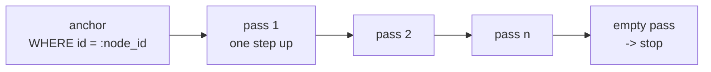

# Chapter 9 · Recursive CTEs

> Volume III · The Rebuild
> Written at M2 · **built and tested** · last verified 2026-11-14

The tool that makes an adjacency list practical: a single SQL statement that walks a chain of
unknown length.

## How it works

A recursive common table expression has two halves joined by `UNION ALL`. The first is the
**anchor** — the starting row. The second is the **recursive term**, which joins the table back
to the CTE itself. PostgreSQL runs the anchor once, then runs the recursive term repeatedly,
each pass fed only the rows the previous pass produced, until a pass produces nothing.

```sql
WITH RECURSIVE ancestry AS (
    -- anchor
    SELECT id, parent_id, name, type, 0 AS depth
      FROM nodes
     WHERE id = :node_id
       AND owner_id = :owner_id
    UNION ALL
    -- recursive term: one step up, repeated
    SELECT n.id, n.parent_id, n.name, n.type, a.depth + 1
      FROM nodes n
      JOIN ancestry a ON n.id = a.parent_id
     WHERE n.owner_id = :owner_id          -- I6
       AND a.depth < :max_depth            -- I7
)
SELECT id, parent_id, name, type, depth FROM ancestry ORDER BY depth
```

## Watching it run

For `root → Docs → Work → notes.txt`, starting at `notes.txt`:

| Pass | Working set in | Rows produced | Accumulated |
|---|---|---|---|
| anchor | — | notes.txt (depth 0) | notes.txt |
| 1 | notes.txt | Work (depth 1) | notes.txt, Work |
| 2 | Work | Docs (depth 2) | …, Docs |
| 3 | Docs | root (depth 3) | …, root |
| 4 | root | none — `parent_id` is NULL | stop |

Four index lookups, one round trip, one statement.

The naive alternative is a loop in Python issuing one query per level — four round trips here,
fifteen on a deep tree, each paying full network latency. On a database with 20 ms round-trip
time that is the difference between 25 ms and 300 ms for the same answer.



## Two predicates that are not optional

### The owner filter goes in the recursive term, not just the anchor

This is the one that bites. Filtering only the anchor looks sufficient — the walk starts at a
node you own, so surely it stays in your tree?

It does not. Attach a node under a foreign folder and the walk climbs straight out: the
ownership check on the *starting* node passes, and the response then carries **a stranger's
folder names**. Breadcrumbs become a read primitive against someone else's tree.

> `test_path_does_not_cross_owner` asserts both halves — that a foreign node's path is a 404,
> and that a legitimate path contains only the caller's own names.

### The depth bound

The CTE is `UNION ALL`, which does not deduplicate. On cyclic data an unbounded walk allocates
until it exhausts memory or hits a timeout — and **the cycle detector would be the first
casualty of the cycle it exists to detect.**

`a.depth < :max_depth` makes that impossible. PostgreSQL 14+ also offers a `CYCLE` clause; the
depth bound is used here because it doubles as the I7 enforcement the application needs anyway.

## Using it to prevent a cycle

The cycle check is the same walk, asked as a question. Before moving node X under parent P, walk
upward *from P* and ask whether X appears:

```sql
SELECT EXISTS (SELECT 1 FROM ancestry WHERE id = :candidate_id)
```

Moving X under its own descendant means X is somewhere on the path from that descendant up to
the root. That is precisely what this returns. One query, any depth, no loop.

## The same shape, three times

| Query | Direction | Used by |
|---|---|---|
| `_ANCESTRY` | up | breadcrumbs, destination depth |
| `_SUBTREE_HEIGHT` | down | the depth bound (I7) |
| `_LOCK_CHAIN` | up, then `FOR NO KEY UPDATE` | the move's serialisation point |

The descending walk exists because the depth bound needs the **height of the subtree being
carried**, and an ascending walk never sees it. See [Chapter 4](04-the-eight-invariants.md).

## Where you have seen this before

Breadcrumbs. Every time a site shows *Home › Electronics › Phones › Cases*, something walked
that chain. Most implementations do it with a loop and N queries. The same shape powers
org-chart reporting lines, threaded-comment permalinks, and dependency resolution in package
managers.

---

**And it is still not enough.** This check is correct for one request at a time. Run two
simultaneously and both can return false, both can commit, and the tree still ends up with a
cycle.

**Next:** [Chapter 10 · The race nobody sees](10-the-race-nobody-sees.md)
