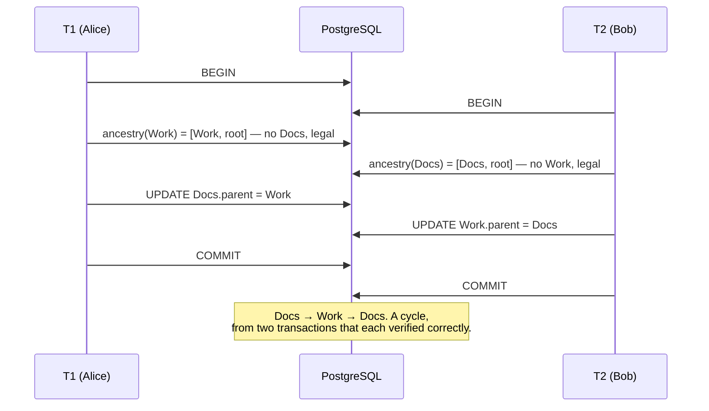
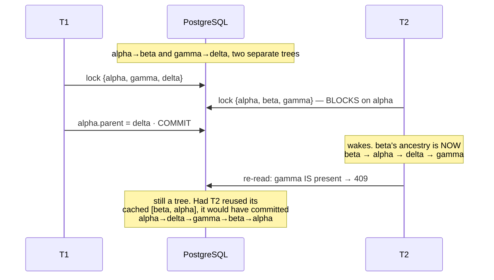

# Chapter 10 · The race nobody sees

> Volume III · The Rebuild
> Written at M2 · **built and tested against two real connections** · last verified 2026-11-14

Two users. Two legal moves. One corrupt tree. This chapter separates a developer who writes
validation from an engineer who understands transactions.

## The anomaly

Alice moves `Docs` into `Work`. At the same moment Bob moves `Work` into `Docs`. Both are
siblings at the root, so each move is individually legal and **each cycle check passes
honestly**.



This is **write skew**: each transaction reads a set of rows, decides from them, and writes to a
*different* row. Neither overwrites the other, so no conflict is detected, yet the combined
result violates a constraint spanning both. Under PostgreSQL's default `READ COMMITTED` nothing
prevents it.

## The fix

```sql
BEGIN;

-- 1. Lock the node being moved together with the destination's ancestry chain.
WITH RECURSIVE ancestry AS (
        SELECT id, parent_id, 0 AS depth FROM nodes
         WHERE id = :new_parent_id AND owner_id = :owner_id
    UNION ALL
        SELECT n.id, n.parent_id, a.depth + 1 FROM nodes n
          JOIN ancestry a ON n.id = a.parent_id
         WHERE n.owner_id = :owner_id AND a.depth < :max_depth
)
SELECT id FROM nodes
 WHERE owner_id = :owner_id
   AND (id = :node_id OR id IN (SELECT id FROM ancestry))
 ORDER BY id
   FOR NO KEY UPDATE;

-- 2. Re-run the ancestry walk AS A NEW STATEMENT. If :node_id appears, 409.
-- 3. UPDATE nodes SET parent_id = :new_parent_id WHERE id = :node_id AND owner_id = :owner_id;

COMMIT;
```

## Four details, each of which was wrong first

### 1 · The lock that does the work is on the moved node

Not the destination chain. Two moves that could jointly close a cycle **always** have one's
moved node inside the other's destination ancestry, so their lock sets necessarily intersect —
including across multi-root forests and three-way races.

Getting this backwards matters, because a test built on the destination-chain story is the
two-cycle above, and **the two-cycle passes against a broken implementation.** The moved node is
in both lock sets by construction, so it serialises whatever else you got wrong.

### 2 · Step 2 must be a genuinely new statement

`FOR NO KEY UPDATE` **does not refresh a recursive CTE.** `LockRows` sits above the plan and
EvalPlanQual re-checks only the outer qual, not the CTE's contents. Reusing the rows step 1
returned — the obvious optimisation, and one nothing in the SQL warns you against — admits a
four-node cycle:



> `test_concurrent_move_four_cycle` drives exactly this, on two real connections, and asserts
> that T2 is **still blocked** before T1 commits. If the lock sets did not overlap, the whole
> argument would be wrong and the test says so.

### 3 · `FOR NO KEY UPDATE`, not `FOR UPDATE`

`FOR UPDATE` conflicts with `FOR KEY SHARE` — the lock an `INSERT` takes on its parent row for
the foreign-key check. So holding an ancestry chain under `FOR UPDATE` would block anyone
creating a node underneath it, turning a correctness mechanism into a denial-of-service against
ordinary use.

`FOR NO KEY UPDATE` still excludes other moves, which is all the argument above needs.

> `test_move_does_not_block_unrelated_insert` holds a chain and inserts a child beneath it. The
> session's `lock_timeout` is four seconds, so a conflict would raise rather than hang.

### 4 · `ORDER BY id` is a convention, not a guarantee

It gives every transaction the same lock order, so two overlapping chains queue instead of
deadlocking. But a concurrent cascading delete locks in **scan** order, not id order, so `40P01`
is still reachable.

The lock order makes a deadlock rare. It does not make it impossible — which is why `move`
retries on `40P01` rather than carrying a comment claiming it cannot happen.

## The honest name for this design

Not "a row-locked transaction". The lock set is itself computed from an **unlocked** read, which
is the other reason step 2 re-reads. Accurately:

> **An optimistic ancestry check plus best-effort chain serialisation under row locks, with a
> retry on deadlock.**

## Alternatives, and why not

| Approach | Verdict |
|---|---|
| `SERIALIZABLE` + retry on `40001` | Provably correct, three lines. Rejected because it pushes a retry loop into every caller and makes every transaction pay for a guarantee only `move` needs. A defensible choice — the trade-off is scope of cost, not correctness. |
| `pg_advisory_xact_lock(owner_id)` | Genuinely attractive: one lock per owner, and every tree belongs to exactly one user. Rejected because it serialises *all* of that user's writes, including moves in unrelated parts of their tree. Worth revisiting if contention ever appears. |
| Application-level mutex | Does not survive more than one process. |

Full reasoning in [`docs/adr/0003`](../adr/0003-concurrent-move-serialisation.md).

## Why the test could not be faked

A mocked session cannot block on another session's row lock. The property under test — that the
second transaction *waits* and then re-reads a tree the first one changed — only exists against
a real database, on two real connections, committing independently.

That is also why the suite truncates between tests instead of wrapping each in a transaction and
rolling back. Inside one outer transaction there is nothing to block on, and the tests that
matter most would pass vacuously.

---

**Next:** [Chapter 11 · The API contract](README.md) — written at M3.
