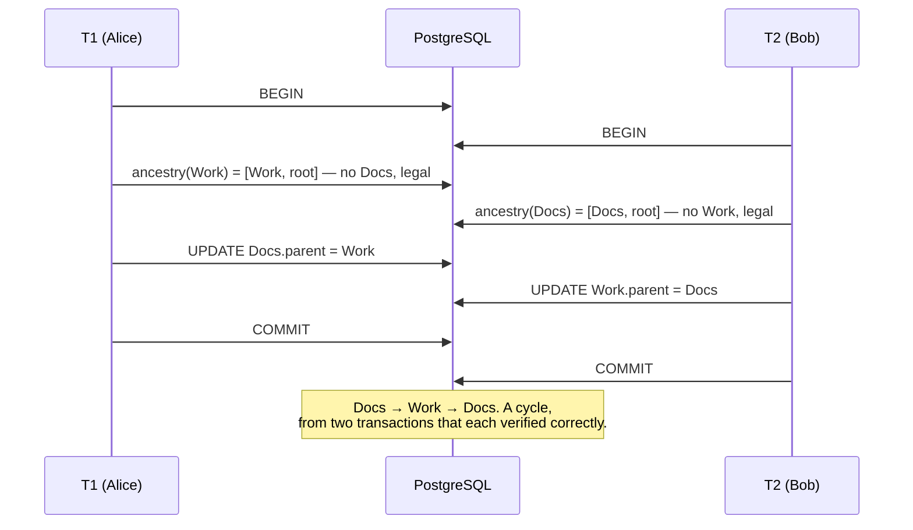
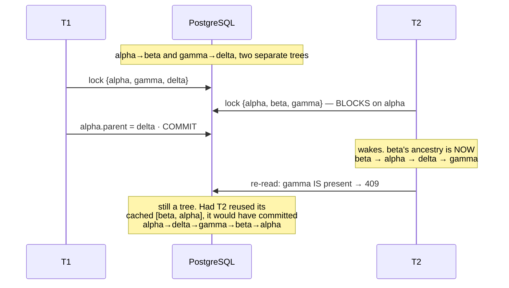

# Chapter 10 · The race nobody sees

> Volume III · The Rebuild
> Written at M2 · **built and tested against two real connections** · last verified 2026-11-14

Two users. Two legal moves. One corrupt tree. This chapter separates a developer who writes
validation from an engineer who understands transactions.

## The anomaly

Alice moves `Docs` into `Work`. At the same moment Bob moves `Work` into `Docs`. Both are
siblings at the root, so each move is individually legal and **each cycle check passes
honestly**.



This is **write skew**: each transaction reads a set of rows, decides from them, and writes to a
*different* row. Neither overwrites the other, so no conflict is detected, yet the combined
result violates a constraint spanning both. Under PostgreSQL's default `READ COMMITTED` nothing
prevents it.

## The fix

```sql
BEGIN;

-- 1. Lock the node being moved together with the destination's ancestry chain.
WITH RECURSIVE ancestry AS (
        SELECT id, parent_id, 0 AS depth FROM nodes
         WHERE id = :new_parent_id AND owner_id = :owner_id
    UNION ALL
        SELECT n.id, n.parent_id, a.depth + 1 FROM nodes n
          JOIN ancestry a ON n.id = a.parent_id
         WHERE n.owner_id = :owner_id AND a.depth < :max_depth
)
SELECT id FROM nodes
 WHERE owner_id = :owner_id
   AND (id = :node_id OR id IN (SELECT id FROM ancestry))
 ORDER BY id
   FOR NO KEY UPDATE;

-- 2. Re-run the ancestry walk AS A NEW STATEMENT. If :node_id appears, 409.
-- 3. UPDATE nodes SET parent_id = :new_parent_id WHERE id = :node_id AND owner_id = :owner_id;

COMMIT;
```

## Four details, each of which was wrong first

### 1 · The lock that does the work is on the moved node

Not the destination chain. Two moves that could jointly close a cycle **always** have one's
moved node inside the other's destination ancestry, so their lock sets necessarily intersect —
including across multi-root forests and three-way races.

Getting this backwards matters, because a test built on the destination-chain story is the
two-cycle above, and **the two-cycle passes against a broken implementation.** The moved node is
in both lock sets by construction, so it serialises whatever else you got wrong.

### 2 · Step 2 must be a genuinely new statement

`FOR NO KEY UPDATE` **does not refresh a recursive CTE.** `LockRows` sits above the plan and
EvalPlanQual re-checks only the outer qual, not the CTE's contents. Reusing the rows step 1
returned — the obvious optimisation, and one nothing in the SQL warns you against — admits a
four-node cycle:



> `test_concurrent_move_four_cycle` drives exactly this, on two real connections, and asserts
> that T2 is **still blocked** before T1 commits. If the lock sets did not overlap, the whole
> argument would be wrong and the test says so.

### 3 · `FOR NO KEY UPDATE`, not `FOR UPDATE`

`FOR UPDATE` conflicts with `FOR KEY SHARE` — the lock an `INSERT` takes on its parent row for
the foreign-key check. So holding an ancestry chain under `FOR UPDATE` would block anyone
creating a node underneath it, turning a correctness mechanism into a denial-of-service against
ordinary use.

`FOR NO KEY UPDATE` still excludes other moves, which is all the argument above needs.

> `test_move_does_not_block_unrelated_insert` holds a chain and inserts a child beneath it. The
> session's `lock_timeout` is four seconds, so a conflict would raise rather than hang.

### 4 · `ORDER BY id` is a convention, not a guarantee

It gives every transaction the same lock order, so two overlapping chains queue instead of
deadlocking. But a concurrent cascading delete locks in **scan** order, not id order, so `40P01`
is still reachable.

The lock order makes a deadlock rare. It does not make it impossible — which is why `move`
retries on `40P01` rather than carrying a comment claiming it cannot happen.

## The honest name for this design

Not "a row-locked transaction". The lock set is itself computed from an **unlocked** read, which
is the other reason step 2 re-reads. Accurately:

> **An optimistic ancestry check plus best-effort chain serialisation under row locks, with a
> retry on deadlock.**

## Alternatives, and why not

| Approach | Verdict |
|---|---|
| `SERIALIZABLE` + retry on `40001` | Provably correct, three lines. Rejected because it pushes a retry loop into every caller and makes every transaction pay for a guarantee only `move` needs. A defensible choice — the trade-off is scope of cost, not correctness. |
| `pg_advisory_xact_lock(owner_id)` | Genuinely attractive: one lock per owner, and every tree belongs to exactly one user. Rejected because it serialises *all* of that user's writes, including moves in unrelated parts of their tree. Worth revisiting if contention ever appears. |
| Application-level mutex | Does not survive more than one process. |

Full reasoning in [`docs/adr/0003`](../adr/0003-concurrent-move-serialisation.md).

## The retry branch, and the bug underneath it

The lock ordering above makes a deadlock unlikely, not impossible, and it does nothing at all
about the commoner failure: a chain held by a slow transaction, where the mover simply waits past
its `lock_timeout`. So `move` wraps `_move_once` in a bounded retry.

```python
RETRYABLE = frozenset({"40P01", "55P03"})   # deadlock, lock_not_available
TIMEOUT   = "57014"                         # query_canceled -- deliberately NOT retryable
```

Three sqlstates, three different answers:

| sqlstate | Meaning | Answer | Why |
|---|---|---|---|
| `40P01` | deadlock_detected | Retry, up to 3 attempts | The database already rolled one side back. The other side will usually win on the next pass. |
| `55P03` | lock_not_available | Retry, up to 3 attempts | Someone held the chain longer than `lock_timeout`. They have probably finished by now. |
| `57014` | query_canceled | **503, no retry** | A statement that exceeded its budget will exceed it again. Retrying burns the timeout twice and still fails. |

The backoff is linear with jitter. Without jitter, two transactions that collide retry in step and
collide again on the same schedule.

Review found this branch had **zero coverage** — roughly twenty-five lines at the centre of the
concurrency design, never once executed. The existing four-cycle test releases its lock after
0.6 s against a 4 s `lock_timeout`, so it never waits long enough to enter the branch at all.

### Writing a test that waits for a fact, not a clock

The instinct is `time.sleep(1)` and hope. That produces a test which passes on a quiet machine and
fails on a busy one, which is worse than no test — it trains you to re-run CI instead of reading
it.

The branch logs when it retries, so the test can wait on the log:

```python
assert _wait_for(lambda: _retries(retry_log) >= 1), \
    "the service never logged a retry — the lock timeout did not reach the retry branch"
release.set()          # let the holder go only once a retry has genuinely happened
```

The contending transaction is released by the *fact* that a retry occurred, not by a hopeful
interval. Nothing in the test depends on how long a backoff takes.

### Then both tests failed, and the code was correct

```
FAILED test_lock_timeout_is_retried_and_then_succeeds
  AssertionError: the service never logged a retry
FAILED test_retries_are_bounded_and_then_the_error_escapes
  AssertionError: expected 2 retries before giving up, saw 0
```

The second failure is the interesting one, because of the assertion immediately above it, which
**passed**:

```python
assert sqlstate in RETRYABLE      # passed: the escaping error was 55P03
assert _retries(retry_log) == 2   # failed: saw 0
```

A retryable error escaped the loop having logged nothing. Read the loop and that is not reachable.
The only exit on attempt 1 is `if sqlstate not in RETRYABLE: raise`, and the sqlstate *was* in
`RETRYABLE`. The exit that does fire — `if attempt == _MAX_ATTEMPTS: raise` — can only be reached
after two `log.warning` calls.

So the loop was not the problem. The log records were not arriving.

### `disable_existing_loggers` defaults to True

`migrations/env.py` opens the way every Alembic environment does:

```python
if config.config_file_name is not None:
    fileConfig(config.config_file_name)        # the bug
```

`logging.config.fileConfig` disables every logger its ini does not name, **by default**.
`alembic.ini` names three: `root`, `sqlalchemy.engine`, `alembic`. It does not name
`file_explorer.services.tree`, and it does not name `flask.app`.

And `conftest.py` runs migrations in-process, once per session:

```python
@pytest.fixture(scope="session")
def app() -> Iterator[Flask]:
    application = create_app()
    with application.app_context():
        upgrade()                               # <- fileConfig runs here
```

pytest imports the test modules during collection, so `file_explorer.services.tree` is registered
*before* that fixture runs. `fileConfig` then switches it off.

The mechanism, reproduced in fifteen lines of standard library — no database, no SQLAlchemy:

```
before upgrade(): disabled=False  records=['before migrations']
after  upgrade(): disabled=True   records=['before migrations']     <- the warning vanished
with the fix    : disabled=False  records=['before migrations', 'contention on move, retrying']
```

What makes this worth a section is *where* the record dies. `Logger.warning` opens with
`if self.isEnabledFor(WARNING)`, and `isEnabledFor` returns `False` for a disabled logger before
any handler is consulted. There is no exception, no fallback, no `logging.lastResort`. The call
succeeds and does nothing. Grep the codebase for the problem and there is nothing to find: the
service code is correct, the handler is correctly attached, the level is correctly set.

### The real cost was never the test

Two red tests is the cheap version of this bug. The expensive version is a process that runs
`flask db upgrade` on startup and then serves traffic: for the rest of its life it emits no
contention warnings, and `app.logger.exception("health check failed")` in the `/api/v1/health`
handler writes nothing anywhere. The service is silent in exactly the conditions you built the
logging for — and silence reads identically to health.

That is the same shape as the outage in [Chapter 7](07-the-silent-outage.md): a signal that cannot
fail is not a signal. There it was a health check that returned a constant. Here it is a log line
that is dropped before it reaches a handler. Both stay green while the thing they describe is gone.

The fix is one keyword:

```python
fileConfig(config.config_file_name, disable_existing_loggers=False)
```

### The guard, and why it is written the obvious-looking wrong way round

```python
registry = logging.Logger.manager.loggerDict
assert SERVICE_LOGGER in registry, "…so this test proves nothing"

silenced = sorted(
    name for name, logger in list(registry.items())
    if isinstance(logger, logging.Logger) and logger.disabled
    and (name.startswith("file_explorer") or name.startswith("flask"))
)
assert not silenced
```

The natural way to write this is `logging.getLogger(name).disabled`. That version is useless, and
not obviously so: **`getLogger` creates the logger if it is absent**, freshly enabled. A logger
that did not exist when the migration ran is created, enabled, at the moment the test asks about
it — so the assertion passes regardless of what the migration did. The test would be green with
the bug fully restored.

Reading `loggerDict` asks what is actually registered rather than conjuring it. The membership
assertion above it is the other half: if the service logger is ever *not* registered by that
point, the scan has nothing left to check and the test says so instead of passing quietly.

Verified by restoring the bug: with `fileConfig(path)` the scan returns
`['file_explorer.services.tree', 'flask.app']` and the test fails; with
`disable_existing_loggers=False` it returns `[]` and passes.

## Why the test could not be faked

A mocked session cannot block on another session's row lock. The property under test — that the
second transaction *waits* and then re-reads a tree the first one changed — only exists against
a real database, on two real connections, committing independently.

That is also why the suite truncates between tests instead of wrapping each in a transaction and
rolling back. Inside one outer transaction there is nothing to block on, and the tests that
matter most would pass vacuously.

---

**Next:** [Chapter 11 · The API contract](README.md) — written at M3.
