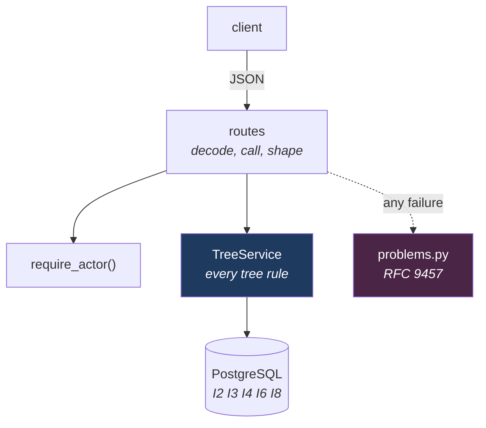

# Chapter 11 · The API contract

> **Volume III · The surface.** What a client can rely on, and what happens when it asks for
> something impossible. The tree logic is chapters 5, 6, 9 and 10; this is the layer over it.
> Written at M3b · last verified 2026-11-21

The routes are thin on purpose. Every one does the same four things — ask who is calling, decode
the inputs, call one service method, shape the output — and none of them contains a rule about
trees.

That is not tidiness. The concurrency tests drive `TreeService` on two real connections; they
cannot reach a rule that lives in a route. **A rule in the HTTP layer is a rule those tests cannot
test.**



---

## Why `/roots` is its own route

The obvious design is `GET /nodes?parent_id=<id>`, with something meaning "the roots". There is no
good something.

A root has `parent_id` of `null`, and a query string cannot carry null. `?parent_id=` is the empty
string, which a typed schema rejects with 422. Omitting the parameter entirely is
indistinguishable from "every node I own". Both readings are defensible, and that is exactly the
problem — the endpoint has two meanings and the client picks one by accident.

Two routes have one meaning each:

| | |
|---|---|
| `GET /api/v1/roots` | the caller's top level |
| `GET /api/v1/nodes/{id}/children` | inside one folder |

The same reasoning puts move on `POST /nodes/{id}/move` rather than `PATCH /nodes/{id}` with a
`parent_id` field. Moving is not a field assignment. It has its own failure modes — a cycle, the
depth cap, a file as the destination, contention — and folding it into rename means every one of
those can come back from a request that was only trying to change a name.

---

## Every failure is a problem document

The failure this guards against is an API that is careful about the errors it anticipated and
falls back to the framework for the rest. A client then gets tidy JSON for a duplicate name and an
HTML page for a typo in the URL, and has to handle both.

Four handlers, and the last two are the ones usually missing:

| Handler | Catches | Without it |
|---|---|---|
| `TreeError` | the domain errors | — |
| `ValidationError` | marshmallow | — |
| `HTTPException` | 404 on an unrouted path, 405, 413, 429 | **HTML** |
| `Exception` | anything unanticipated | **a stack trace** |

Every response carries `application/problem+json`, which is the point of RFC 9457: a client tells
a problem from a body by media type rather than by guessing from the shape.

### Registration order is load-bearing

flask-smorest installs its own `HTTPException` handler during `Api(app)`, and Flask keeps handlers
in a dict keyed by exception class — so the later registration **replaces** the earlier one. There
is no ordering and no fallthrough. Register `problems.py` before `Api(app)` and smorest's handler
is the one that survives, so 404, 405 and 413 come back in *its* shape while the domain errors are
RFC 9457 — the exact split the module exists to prevent, reintroduced by two lines being in the
wrong order.

```python
api = ProblemApi(app)
api.register_blueprint(nodes_blp)
problems.register(app)        # after, deliberately
```

This cost a CI cycle and six failing tests, all of which said only "content type is not
problem+json".

### What is not in a problem document

A domain problem has **no** `detail` at all. The class's title is the `title`, and the only thing
that could go in `detail` is the submitted value.

> `test_a_duplicate_name_response_does_not_echo_the_name` creates `quarterly-layoffs`, creates it
> again, and asserts the string does not appear in the 409. A duplicate-name response that echoes
> the name tells anyone who can see it what is already in that folder.

And nothing carries the database's account of what went wrong — the other half of A-1, asserted at
the boundary a caller actually sees:

```python
assert "[SQL:" not in rendered
assert "parameters" not in rendered
assert "Traceback" not in rendered
```

---

## The document and the service have to agree

This is the finding worth the chapter.

flask-smorest documents its own error schema on every operation: `code` as an **integer**, plus
`message`. The handlers send RFC 9457, where `code` is a **string** and there is a `type`, `title`
and `status`. Left alone, the generated document promises one shape and the service sends another.

Nothing fails. The tests pass, the API works, the document validates. A generated TypeScript
client simply has the wrong error type on every route, and the first anyone knows is when error
handling that type-checked cleanly does nothing useful in production.

```python
class ProblemApi(Api):
    ERROR_SCHEMA = ProblemSchema
```

> `test_the_documented_error_shape_is_the_one_actually_sent` checks both halves — that the document
> says `string`, and that a real 404 body agrees with it. One without the other is how they drift.

### `new_parent_id` must be nullable, and that is C-03

The same class of defect, one field along, and worse.

`null` is how a node is moved to the root. Typed as a plain integer, the generated client is
`new_parent_id: number` and **move-to-root stops being expressible** — so the frontend grows a
workaround, and the feature quietly stops existing. That is F-06, and it is completely invisible
from Python, where `None` passes through happily.

```json
"new_parent_id": {
  "description": "null moves the node to the root",
  "nullable": true,
  "type": "integer"
}
```

> The test parses the generated document and asserts that field is nullable. The document is also
> committed, and CI fails when it drifts — a contract that exists only at runtime cannot be
> reviewed in a diff.

---

## The authentication seam

<ins>**This section described a seam waiting to be used. It has been used — M5 landed on
17–18 November, and the paragraphs below are kept because the seam working as designed is the
claim they were making.**</ins> What follows is how it stood at M3b;
[chapter 12](12-identity-and-isolation.md) is what went through it.

At M3b there was no authentication. Every route called `require_actor()`.

```python
def require_actor() -> int:
    actor = current_app.config.get("DEV_ACTOR_ID")
    if actor is None:
        raise Unauthorized(...)
    return int(actor)
```

**M5 changes the body of one function.** The alternative — adding authentication later by
threading an actor through every route — is how a service ends up with two or three routes that
forgot, and those are precisely the ones that let one user read another's tree.

> <ins>**It held.**</ins> M5's diff is a module, a service, a blueprint and the fixtures.
> **Not one route changed.** `require_actor()` now reads an answer that a `before_request` hook
> has already settled onto `g`, rather than computing one — which also moved authentication
> ahead of `@blp.arguments`, so an unauthenticated caller sending a nonsense body gets 401
> instead of a 422 describing a schema they are not allowed to use.

Two details make it a seam rather than a stub:

- **`DEV_ACTOR_ID` has no default.** A deployment that forgets it answers 401, not everything.
  Failing closed is the only safe direction for this particular setting.
- **401 is documented on every route today.** A client generated now already handles being
  unauthenticated, so M5 is not a breaking change for it either.

> `test_every_route_documents_401` walks the generated document and fails on any operation that
> does not declare it.

---

## The bounds, and which of them is honest

| Bound | Value | Honest about |
|---|---|---|
| `MAX_CONTENT_LENGTH` | 16 KB | A name is at most 255 characters. Werkzeug raises 413 before reading the body, so without it the limit is however much memory the worker has. |
| Page size | 50 default, 200 maximum | A caller-supplied limit is an input, not an instruction. |
| Rate limit | 120/minute global; **10/minute** on the credential routes, **5/minute** on guest sign-in | **In-memory, so per process** — this deployment runs two gunicorn workers, so a caller gets the configured limit twice over, and a restart clears it. Measured, not assumed: twelve rapid requests returned two interleaved `X-RateLimit-Remaining` sequences with two different `X-RateLimit-Reset` values. The sharper problem is the other direction: it keys on `remote_addr`, so behind a proxy without `ProxyFix` every caller in the world shares one bucket and the limit becomes an outage switch. `TRUST_PROXY_HOPS` decides which; it defaults to 0 and is **3** in production, measured from the access log. |
| `Cache-Control` | `no-store`, everywhere | Every body is one owner's tree, and identity becomes a cookie at M5 — which a CDN does not key on. |

The rate limit row is the one worth reading. It is wrong anywhere but a single instance, and the
comment in the configuration says so rather than implying a guarantee it does not have. Pointing
`RATELIMIT_STORAGE_URI` at Redis fixes it; there is no Redis on a free tier.

### And a 429 that is not this limiter at all

<ins>Added 21 November.</ins> The demo returned `request failed with 429` to a visitor, and the
first instinct was that one of the limits above had been hit. **It had not.** Measured through
the rewrite before anything was changed:

```
HTTP/2 429
content-type: text/plain; charset=utf-8
x-render-routing: hibernate-rate-limited

Too Many Requests
```

That is **the host**, throttling how often a sleeping free instance may be woken — a constraint
no pricing page mentions and which only appears after somebody has been waking the thing
repeatedly. Two consequences for this chapter.

First, **a client cannot assume a 429 is ours.** Ours is an RFC 9457 document with
`code: RATE_LIMITED`; the host's is `text/plain`, so nothing parses and the problem is `null`.
The client now tells them apart on exactly that and says different things: ours clears in
seconds, the host's in minutes and no button helps.

Second, it is the reason `explainFailure` exists in the shape it does. It had handled three
statuses by name and returned the exception's own message for the rest — which is
`request failed with <status>` whenever the body is not a problem document. **The function
opened with a comment forbidding precisely that.** The fix was not a 429 branch; it was removing
every path that can return an unframed message, with a test that drives sixteen statuses rather
than the three somebody thought of.

---

## The cursor

The service's cursor is the sort key itself, `(name, id)`. On the wire it is base64url of those
two joined by a unit separator — opaque, URL-safe, and easy to widen later, because a cursor is a
token the server issued rather than a contract.

It is **not signed**, and does not need to be. Every query it feeds is scoped by `owner_id` from
`require_actor()`, so the worst a forged cursor achieves is skipping part of the forger's own
listing. Signing it would add a key to manage in exchange for nothing.

---

## Questions you will be asked

**Q20. Why POST for move rather than PATCH?**
Moving is an operation, not a field assignment. It has failure modes rename does not have — cycle,
depth, file-as-destination, contention leading to 503 — and folding it into `PATCH /nodes/{id}`
means a request that only wanted to change a name can come back with any of them. A separate
endpoint keeps each route's failure set small enough to document honestly.

**Q21. Why RFC 9457 rather than your own error shape?**
Because the shape is the smaller half of the problem. The hard part is that *every* failure uses
it, including the ones the framework raises, and an existing specification settles the argument
about field names so the remaining work is making the coverage complete. `application/problem+json`
also lets a client distinguish a problem from a body without inspecting it.

**Q22. Your rate limiter is in-memory. Isn't that broken?**
Across more than one worker, yes — the effective limit is multiplied by the worker count and a
restart clears it. It is correct for one free-tier instance, which is what this runs on, and the
configuration says so in a comment rather than implying otherwise. `RATELIMIT_STORAGE_URI` points
it at Redis when there is one. The thing I would not accept is a limiter that looks shared and is
not.

**Q23. Why is `new_parent_id` nullable instead of having a separate "move to root" endpoint?**
Both work. Nullable keeps one code path for move, and the destination genuinely is `null` in the
data model — a root's `parent_id` is NULL, not a sentinel. The risk is that the generated client
cannot express it, which is why there is a test that parses the document and asserts the field is
nullable rather than trusting that marshmallow did the right thing.

**Q24. You return 404 for a node that exists but belongs to someone else. Why not 403?**
A 403 confirms the row exists. Node ids are sequential, so a client could walk the id space and
map out how much data another user has. The two cases must be indistinguishable — same status,
same body — and the service produces the 404 before taking any lock, so the *timing* does not
separate them either. A lock wait on a foreign id would leak through response time, and no amount
of matching the body would close that.

---

**Next:** [Chapter 12 · Identity and isolation](12-identity-and-isolation.md)
