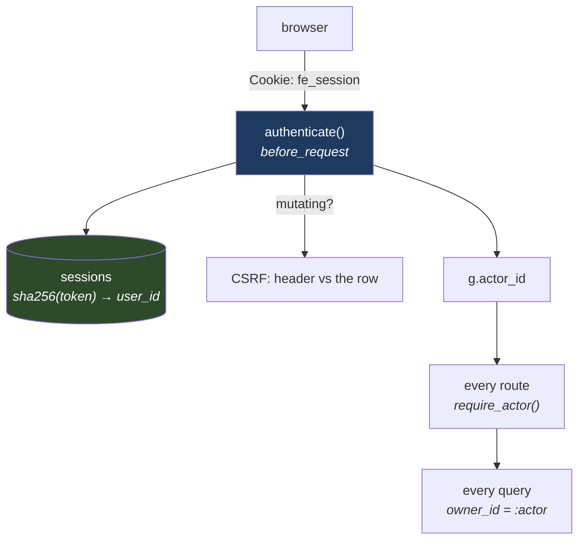

# Chapter 12 · Identity and isolation

> **Volume III · The surface.** Who is calling, how the answer is carried, and what stops one
> person reaching another's tree. The contract itself is chapter 11; this is the part of it that
> decides whether the contract is addressed to anyone in particular.

The seam was built three milestones before it was used, and that is the whole story of this
chapter. Every route already called one function to ask who was calling. M5 changed the body of
that function and **not a single route**.



---

## The function that was always going to change

```python
# M3b, and for three milestones
def require_actor() -> int:
    actor = current_app.config.get("DEV_ACTOR_ID")
    if actor is None:
        raise Unauthorized(...)
    return int(actor)
```

It authenticated nothing. It returned a configured id, and `DEV_ACTOR_ID` had **no default**, so a
deployment that forgot it answered 401 to everything rather than serving somebody's tree to
everybody.

The alternative — add authentication later by threading an actor through every route — is how a
service ends up with two or three routes that forgot, and those are exactly the ones that let one
user read another's tree. One function is one diff.

It worked. M5's diff is this module, a service, a blueprint and the test fixtures. The routes are
untouched, and `401` had been in the published OpenAPI document since M3b, so a client generated
against the old document already handled being signed out.

---

## Why the session is a row and not a token

The decision went the other way first. D-05 said **JWT in an httpOnly cookie**, and the reasoning
recorded against it — a token in `localStorage` is readable by any script that reaches the page,
so one XSS becomes a silent account takeover — is correct and is still the reason the credential
lives in a cookie.

What that decision never compared was *stateless against stateful*. A review before any code was
written asked the question an interviewer asks first:

> Why a JWT at all? You query PostgreSQL on every request anyway. An opaque session id in a table
> is simpler, revocable instantly, and does not need you to reason about `alg` confusion, clock
> skew or refresh rotation.

**A JWT buys exactly one thing: verification without touching the database.** That is worth paying
for when verification has to happen where the database is not — across services, at an edge, under
load that would not survive the extra read. This application queries PostgreSQL on every request
from a single free instance. The benefit cannot be collected here, and every cost still is.

And the design was already half-stateful. `SECURITY.md` promised a refresh token, and a refresh
token that cannot be revoked or reuse-detected needs a row anyway. The table was arriving whatever
happened; the JWT would have been a session id with extra steps.

So: **the session is a row.** D-21 amends D-05 rather than replacing it — the httpOnly `Secure`
cookie stands, the CSRF requirement stands, only the token's *form* changed.

### What the row buys back

- **Logout is a `DELETE`.** Not "clear the cookie and hope". Clearing a cookie is a request to a
  browser; it does nothing about a copy already taken out of one.
- **Deleting a user ends their sessions**, through `ON DELETE CASCADE`, rather than leaving signed
  credentials that outlive the row they name.
- **Nothing has to be pinned.** No `alg`, no issuer, no leeway, no decision about whether a
  refresh token is acceptable on a resource route.

That last one is larger than it looks. The same review enumerated **seven ways** a token-reading
`require_actor()` could return an id it should not: an unverified peek at the claims before
verifying them, a leeway raised to stabilise a test, a token for a deleted user, a subject spelled
`1_0` — which `int()` reads as **10** — a non-numeric subject that becomes a 500, a refresh token
accepted on a resource route, and a token signed by some other service over the same secret.

**Six of the seven do not exist here.** Nothing parses a caller-influenced string into an id: the
actor comes out of a `bigint` column through a foreign key. The seventh is closed by the cascade.

That is the clearest argument for the decision, and it was not the argument anyone started with.

---

## The id is stored hashed, and the CSRF token is not

The cookie carries 32 random bytes. The table stores their SHA-256.

A read of `sessions` — a leaked backup, a log line, a support query — then yields nothing a caller
can present. Same argument as hashing a password, and the reason the primary key *is* the hash
rather than a separate id: a second identifier would be a second thing to look a session up by,
and one of the two would eventually be the one that forgot to check expiry.

**SHA-256 and not Argon2, deliberately.** A password is low-entropy and guessable, so its hash has
to be slow. A 256-bit random token is not guessable at any speed, so slowness buys nothing and
would cost a memory-hard hash on *every request* rather than only at login.

The CSRF token in the same row is stored in the clear, and that is not an oversight. It is not a
credential on its own — without the session cookie it opens nothing — and keeping it readable lets
`/auth/me` hand it back to a tab that reloaded and lost it.

### Double-submit was the wrong shape, and being stateful is what fixed it

`SECURITY.md` §2.5 originally specified a double-submit token "compared against the cookie". That
is defeated by anyone who can write a cookie for the site — a sibling subdomain, or a network
attacker on a plain-HTTP sibling — because it only ever compares the request **to itself**.

The row removes the reason to accept that. It is already being read to authenticate, so comparing
the request's header against a value stored *in the row* costs nothing extra and is a
**synchronizer token**: bound to the session, unforgeable by anyone who cannot read the table.

The test that separates the two is `test_another_sessions_csrf_token_does_not_work` — a real,
live, correctly-shaped token belonging to a *different* session is refused. A double-submit check
cannot pass that test.

---

## The cookie has to be able to reach the API

This one would have shipped.

The frontend deploys to `*.vercel.app` and the API to `*.onrender.com`. Both suffixes are on the
Public Suffix List, so the two are different **sites**, and a `SameSite=Lax` cookie is refused at
storage time on a cross-site response that is not a top-level navigation. Sign in would return
200, store nothing, and the next request would be a 401 with no error anyone could read.

**And every test would pass.** Flask's test client has no SameSite enforcement at all, and
`localhost:5173` → `localhost:5000` is cross-*origin* but same-*site*, because SameSite compares
the registrable domain and ignores scheme and port. Local development, Compose and CI would all
behave. Only the deployed demo would be broken — the worst possible place for a failure to hide,
on a project whose entire history is a demo that was broken for seventeen months.

The fix is one committed file. `vercel.json` rewrites `/api/*` to the API service, so the browser
only ever talks to one origin: the cookie is same-site, `Lax` is correct and keeps working, and
**CORS disappears entirely** — the allowlist stays empty, which `config.py` had already documented
as the right default.

The guard is a *startup* check, not an HTTP test, because no HTTP test can see this. The two
settings that contradict each other are both configuration, so the contradiction is visible before
a request exists: `create_app` refuses to start when the allowed origins name a different
registrable domain than the API's own while `SameSite` is `Lax` or `Strict`.

---

## Passwords: a published floor, not a library default

argon2id, because it is memory-hard — the cost of a guessing attack scales with RAM as well as
time, which is what makes a GPU farm a poor investment against it.

`argon2-cffi` defaults to roughly **64 MiB, 3 iterations, 4 lanes**. Reasonable on a machine with
memory and cores to spend. This runs on a single free instance with about **512 MB of RAM and a
shared CPU**, where those numbers are wrong twice over: 64 MiB per in-flight hash means a handful
of simultaneous logins is most of the instance, and four lanes on a shared vCPU buys none of the
intended parallelism and costs the scheduling. **A memory-hard hash on a small box is a denial of
service lever pointed at yourself** — the attacker spends one request and the server spends 64 MiB.

So: **19 MiB, 2 iterations, 1 lane — OWASP's minimum recommended configuration.** Not numbers
invented here. The honest reading is that this is the weakest configuration anyone recommends and
it is the right one for this hardware; if the instance grows, `memory_cost` is what to raise
first, because memory is what attacker hardware finds expensive.

Raising it later is safe, and that is a property of the format rather than a hope: an encoded hash
carries the parameters it was made with, so old hashes keep verifying and `check_needs_rehash`
says which to upgrade the next time the password is in hand — which is the only moment it ever is.

### The error that is not in the exception tree you expect

```
Argon2Error(Exception)
  VerificationError
    VerifyMismatchError
  HashingError
InvalidHashError(ValueError)        ← not under Argon2Error
```

`verify()` raises `VerifyMismatchError` for a wrong password and `InvalidHashError` for a stored
value it cannot parse — and **`InvalidHashError` descends from `ValueError`, not from
`Argon2Error`**. So `except VerificationError:`, which is the handler anyone writes first, misses
it entirely and the request becomes a 500.

That was not hypothetical. `users.password_hash` shipped at M2 as `NOT NULL DEFAULT ''`, reasoning
about the *column* — empty rather than nullable, so it would never need tightening later. The
column never needed tightening. **The rows did, and nothing scheduled that**, so every user row
that had ever been inserted held a hash nothing could verify while the schema called it a
credentialed account.

The failure that would have produced is worth stating precisely, because it is not what it looks
like. It is **not a bypass**: `verify()` returns `True` or raises, so nothing falls through. It is
a 500 — and that 500 is an **existence oracle**, because an unknown address answers 401 and a
legacy row answers 500. The empty-hash branch also returns before any Argon2 work, so it is the
same oracle in the timing channel. And `test_login_does_not_enumerate_users`, the test
`SECURITY.md` names for exactly this, would have been written against fixtures that were *all* in
that state and would have passed.

Two things fix it. The column's constraint is now the **encoding** rather than non-emptiness —
`password_hash LIKE '$argon2id$%'` — because a check that only forbids the empty string cannot
tell a hash from the word "hash", and the defect was a shape problem. And `verify_password`
returns `False` for every unverifiable stored value rather than raising, because **the caller
supplied nothing wrong** and a 500 would tell them something about a row they have not proved they
own.

---

## Saying nothing, in two places that usually say something

**Registration answers 202 either way.** A 409 for an address already in use is a plain oracle:
anyone can ask whether a given person has an account here, with no session and no rate limit worth
the name. The body is identical whether an account was created or not.

The cost is real and the document already chose it: a user who mistypes their own address is told
nothing. That is the trade.

**Login does the same work whether the row exists or not.** The usual implementation returns 401
for both an unknown address and a wrong password — correct — and takes a tenth as long for the
unknown one, because the wrong-password path runs Argon2 and the unknown-address path returns
immediately. The status codes match and the clock does not.

So login verifies against a **fixed dummy hash** when it finds no row. The test asserts the
mechanism by counting calls rather than by measuring time, because a timing assertion on a shared
CI runner measures the runner.

The limit of that claim, recorded rather than argued away: this equalises the *server's* work. It
does not control what a loaded instance, a cold compute or the network does to the measurement.
The claim is "the obvious oracle is gone", not "timing cannot leak".

---

## Rate limiting, and the one place the key is still wrong

The limiter keyed on the remote address until M5. That is wrong in two directions at once.

An address is **shared**: everyone behind one NAT, campus or mobile carrier is a single bucket, so
a busy network turns the limit into an outage switch for everybody on it. And an address is
**chosen**: behind a proxy that forwards one, a caller who wants more than their share sets a
different value and gets a fresh bucket. A session is neither — one person, and they cannot mint
another without signing in again.

**The auth endpoints still key on the address**, and the comment in the source says so rather than
pretending otherwise. There is no session on the way to getting one. The alternative is a
per-account limit, and it is worse: *"this address is rate limited"* and *"this address is not"* is
a working answer to **does this person have an account**, available to anyone, without a session.
That is the oracle the section above exists to close, reopened through the side door.

What makes it tolerable rather than merely chosen: argon2id at 19 MiB makes each attempt expensive
for the *server*, so the limit protects the instance. It is not the only thing standing between an
attacker and an account — the password length floor does that.

### A hook ordering that cost a cycle, for the second time

The first version of the session keying **did nothing at all**, and every test but one would have
passed.

Flask-Limiter registers its own `before_request` during `init_app`, and `authenticate` was
registered after it. Flask runs `before_request` in registration order, so the limiter asked who
the caller was before the session had been resolved — and the key stayed the address for every
request, authenticated or not.

This is the `Retry-After` bug from chapter 11 in the opposite direction: that one had to be
registered **first** so it would run **last**, because `after_request` runs in reverse. Same
framework, same class of trap, opposite sign. Both were found by a test that drove the real
behaviour rather than by reading the code.

The cost of authenticating before rate limiting is one indexed primary-key read ahead of a limit
that might refuse the request. Bounded, and not paid by a flood: with no cookie the resolver
returns before it queries anything, so an unauthenticated burst does no database work at all.

---

## 401 before 422

`@blp.arguments` is the outermost decorator on every mutating route, so webargs validated the body
before the view's first line ran. An unauthenticated caller sending a nonsense body got **422, not
401** — and the 422 described the schema they were not allowed to use.

Moving authentication into `before_request` puts it ahead of that for every route at once, which
is also why `require_actor()` now reads an answer rather than computing one. It stays a function,
and every route goes on calling it, because it is the seam that made this milestone a one-file
change and because it fails closed if a future route is ever reached without the hook.

---

## What proves a query someone adds next month is scoped

The isolation tests prove the routes that *exist* refuse. They can prove nothing about a query that
has not been written yet, and that gap was named during review: *nothing makes a query scoped; the
IDOR sweep is a hand-written list.*

Two answers, and the second is the interesting one.

**The sweep is driven off the URL map.** It takes every rule carrying a `node_id` and drives every
method on it against a node belonging to somebody else. The old version asserted the same property
against a hand-written list of six calls — and M5 took the route count to ten, so that list would
have gone on passing while covering six of them. `POST /nodes` is still named separately, because
it carries the parent in the body and a URL walk cannot see it; a route whose ownership check lives
in the body is exactly the kind a sweep misses.

**And a test reads the repository and counts the owner predicates.** Every statement handed to
`text()` must carry one, and the expected count per statement is recorded — because four of the
queries are recursive CTEs and a recursive CTE needs the predicate in the anchor term *and* the
recursive term.

That test was wrong twice before it was right, and the method that found both is the part worth
keeping:

1. The first version asked only whether the SQL mentioned `owner_id` **at all**. Vacuous against
   the mistake that matters — drop the recursive term's predicate and `owner_id` is still in the
   string three more times.
2. The second version walked only module-level assignments, and **seven of the twenty-two owner
   predicates in that file live inside methods**. A third of the repository sat outside a test
   claiming to cover all of it.

Both were found by removing each predicate line in turn and checking which removals the test
noticed. It missed seven of twenty-two. It now misses none, and that exercise costs a minute and is
the only reason either defect is known.

---

## Questions an interviewer asks about this chapter

**Q25. Why a session table rather than a JWT?**
A JWT buys verification without touching the database, and that is worth paying for when
verification has to happen where the database is not. Mine queries PostgreSQL on every request from
one instance, so I cannot collect that benefit and would still pay every cost — no revocation,
`alg` pinning, clock skew, refresh rotation. The session is a row and logout is a `DELETE`. I would
switch the moment there were two instances and a reason not to read the table.

**Q26. Your sessions can be revoked, but what about a stolen session cookie?**
Revocation is the answer to half of it: delete the row and it stops working everywhere at once,
which a stateless token cannot do. The other half is that the cookie is `httpOnly`, so no script
can read it, and `Secure`, so it never crosses plain HTTP. Idle expiry bounds how long an abandoned
session survives. What I do not have is binding to a device or address, and I would not add
address binding — it breaks mobile roaming and buys little against an attacker who already has the
cookie.

**Q27. How is your CSRF token bound to the session?**
It is stored in the session row, so the header is compared against something only the server knows.
That matters because plain double-submit — compare the header to a cookie — is defeated by anyone
who can set a cookie for the site, including from a sibling subdomain, since it only compares the
request to itself. Being stateful made the bound version free: the row is already being read to
authenticate. The test that separates the two offers a real, live token belonging to a different
session and asserts it is refused.

**Q28. Why argon2id, and what parameters?**
argon2id because it is memory-hard, so attacker hardware has to buy RAM and not just cores. 19 MiB,
2 iterations, 1 lane — OWASP's minimum, not the library's default of roughly 64 MiB and 4 lanes.
The default does not fit a 512 MB shared instance: a handful of simultaneous logins is most of the
box, so a memory-hard hash becomes a denial of service lever pointed at myself. The encoded hash
carries its parameters, so raising the cost later is safe and old hashes get upgraded on next
login.

**Q29. How do you stop someone enumerating accounts?**
Registration answers 202 whether or not the address was taken, with the same body. Login verifies
against a dummy hash when it finds no row, so the unknown-address path does the same Argon2 work as
the wrong-password path — otherwise it returns ten times faster and the status codes matching is
irrelevant. And the auth rate limit keys on the address rather than the account, because a
per-account limit answers "does this person have an account" to anyone who asks. What I claim is
that the obvious oracles are gone; I do not claim timing cannot leak, because I cannot control what
a loaded instance does to the measurement.

**Q30. What proves every query is scoped to the right user?**
Three things, and only the third generalises. Every route is driven against another user's node
from the URL map, so a route added later is covered by default. The composite foreign key makes a
cross-owner attachment a database error rather than a service-layer check. And a test reads the
repository and asserts every statement handed to `text()` carries an owner predicate, with the
expected count recorded — because a recursive CTE needs it in both terms, and the version that
only asked "does it mention `owner_id`" was vacuous against exactly that.

---

**Next:** [Chapter 13 · The client that could not say null](13-the-client-that-could-not-say-null.md)
