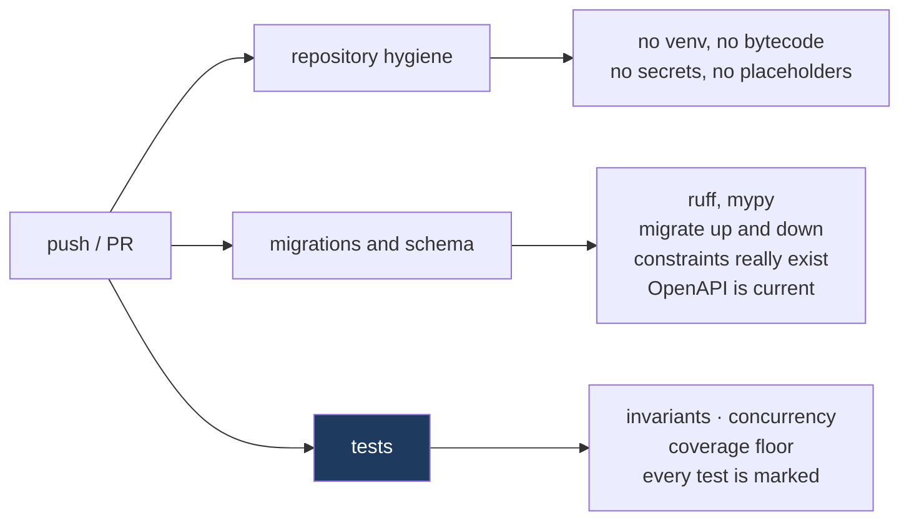

# Chapter 15 · Containers and CI

> **Volume IV · Proof.** Where the tests actually run, and why nothing runs on
> the laptop.

## There is no local runtime

That is a decision, not a gap (D-13). Nothing in this project installs on the
development machine — no PostgreSQL, no Python environment, not even the
linter. Every command is proven in CI or it is not proven.

It sounds like an inconvenience and it mostly is. It has one benefit that has
repeatedly been worth the cost: **"works on my machine" is not available as an
explanation.** Three times during this build a change passed every local
reading and failed in CI for an environmental reason — an import ordering rule,
a type stub that was absent, a format rule about where a long `assert` wraps.
Each would have been invisible on a configured laptop and arrived later as
somebody else's problem.

The cost is real and worth naming: a round trip is ninety seconds instead of
two. That changes how you work. It pushes you towards reading the code harder
before pushing, which is not a bad direction, and towards batching, which is.

### What that cost looked like

Roughly a quarter of all CI runs on this project were spent on code formatting,
and almost all of them on two mistakes: a string split across two lines that
would fit on one, and a wrapped signature that would too.

The fix was not discipline. It was a thirty-line standard-library checker that
runs locally with nothing installed, now covering six rules — split strings
(whole runs, not pairs), wrapped calls, long lines, unused imports, import
ordering, and blank lines around definitions. It is validated against a
CI-verified clean tree, so a false positive is itself a bug in the checker.

> One rule was written and then **removed**: magic trailing commas. It produced
> fourteen false positives against a known-clean tree, because nested structures
> legitimately put several tokens on a line. A checker that disagrees with the
> linter it stands in for is worse than no checker.

---

## Three jobs, and why they are separate



They are separate because they fail for different reasons and at different
speeds. Hygiene is seconds and catches the embarrassing things. Migrations
catches a schema that drifted from the code. Tests are the slow one.

### The schema job asserts the schema, by violating it

The interesting half is not `flask db upgrade`. It is the step afterwards that
**tries to break each constraint and fails the build if the database lets it
through**. A migration that creates a constraint and a constraint that works
are different claims, and only the second one matters.

It also checks the reverse migration. A `downgrade` that has never run is a
rollback plan that does not exist.

### `--locale=C`, and what it hides

```yaml
POSTGRES_INITDB_ARGS: "--locale=C --encoding=UTF8"
```

Deterministic collation, so index ordering matches regardless of the runner's
locale. Good reason, and it has a consequence worth knowing about: the database
default *is* byte order, so any test asserting "ordering is byte order" passes
whether or not the indexes were ever pinned to a collation.

That is why the collation guard reads `pg_index` instead of comparing sort
orders. Confirmed by mutation — run 10 in [`docs/MUTATIONS.md`](../MUTATIONS.md).

### Real PostgreSQL, never SQLite

A service container, not an in-memory substitute. Recursive CTEs,
`SELECT … FOR NO KEY UPDATE`, partial unique indexes and `ON DELETE CASCADE`
all behave differently or not at all on SQLite, and the concurrency tests need
two connections that commit independently — which an in-memory database cannot
give you at all.

**A suite that passes on SQLite has tested a different program.**

---

## Markers, and the test that nothing selects

Two markers: `invariant` and `concurrency`. The split exists because the second
group needs two real connections and takes four times as long, so they run as
separate steps.

Which creates a hole. A test carrying **no** marker is selected by neither
filtered run and is silently never executed. So CI checks for it:

```bash
unmarked=$(pytest --collect-only -q -m "not invariant and not concurrency" | grep -cE '^tests/')
[ "$unmarked" = "0" ] || exit 1
```

`--strict-markers` catches a *misspelled* marker. This catches the opposite — a
test that quietly has none. Both failures are silent, and the silent ones are
the ones worth automating.

### Coverage spans both halves

```bash
pytest -m "not concurrency" --cov=file_explorer --cov-report=
pytest -m concurrency --cov=file_explorer --cov-append --cov-report=
coverage report --show-missing --skip-covered --fail-under=98
```

`--cov-append` matters: the two runs are one suite split by marker, and a
number from half of it would be a lie about the other half.

---

## The OpenAPI document is checked, not just generated

CI regenerates the document and fails if it differs from the committed copy.

A contract that exists only at runtime cannot be reviewed in a diff. Twice in
this project the published document promised something the service does not do
— an integer error code, then `application/json` for every error — and in
neither case did anything fail. The tests passed, the API worked, the document
validated. Committing it is what makes the next such change show up as a diff
somebody has to look at.

---

## What Docker is and is not used for

`docker-compose.yml` describes the local stack: PostgreSQL, the API, the web
app. **CI does not use it.** CI uses GitHub Actions service containers, which
are simpler and faster for the one thing it needs.

So the compose file is documentation of the intended local setup more than a
thing exercised daily, and the README says exactly that rather than implying
otherwise — `make db` works if you have Docker; the application targets do not
yet, because there are no images. A README claiming a command that has never
run is the same defect class as a comment claiming a guarantee the code does
not provide.

---

## The schedule, and why there is no keep-warm

The free tier sleeps after fifteen minutes of inactivity. The obvious fix is a
cron job pinging it every ten minutes, which burns roughly 4,300 Actions
minutes a month to keep a demo warm nobody is looking at.

Instead: a health probe twice on weekdays, at 05:30 and 09:00 UTC — 11:00 and
14:30 in Indian Standard Time, which is when someone might actually open the
link. About 40 minutes a month. The first request after a sleep is slow, and
the README says so.

The probe exits early when `API_URL` is unset, so it is green and silent until
there is something to probe rather than red for months.

---

**Next:** [Chapter 16 · Two repositories become one](16-two-repositories-become-one.md)
