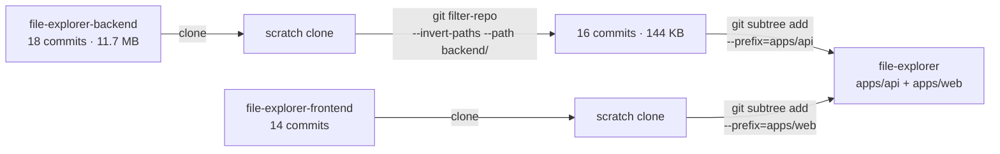

# Chapter 16 · Two repositories become one

> Volume IV · The Practice
> Written at M1 · **done** · last verified 2026-11-14

Not for tidiness. Three of the things worth putting on a résumé are impossible to demonstrate
across two repositories.

## Why

An integration test that drives the API against a real database, a CI pipeline that stands the
whole system up, and a browser test that drags a folder against a live backend — none of them
has a natural home when the halves are separate. They need one checkout, one compose file, one
workflow.

The monorepo is a **precondition**, not a style preference.

## What was in the way

```
file-explorer-backend    18 commits    11.7 MB
  backend/bin/                         <- a committed virtualenv
  backend/lib/python3.12/site-packages/   1,950 files
  (no .gitignore at all)

file-explorer-frontend   14 commits     206 KB
```

The backend repository carried its own virtualenv. Not in the working tree — in **every commit
of its history**, so a clone paid for it whether it wanted to or not.

A detail worth the embarrassment: the committed venv was Python **3.12**, and the deployed
service ran Python **3.11**. Those 11.7 MB were never even the environment that executed.

## The sequence

Order matters. Strip first, graft second — the other way round and the 11.7 MB rides into the
new repository permanently.



```bash
# 1. throwaway clones, outside the repo
git clone https://github.com/vinay1500/file-explorer-backend.git  _src-api
git clone https://github.com/vinay1500/file-explorer-frontend.git _src-web

# 2. strip the venv from EVERY commit, not just the tip
cd _src-api
git filter-repo --invert-paths --path backend/ --path-glob '*__pycache__*' --path-glob '*.pyc'

# 3. graft, WITHOUT --squash
git subtree add --prefix=apps/api ../_src-api master
git subtree add --prefix=apps/web ../_src-web master
```

**Result:** 12 MB → 144 KB before grafting. 1,950 tracked venv files → 0. All 30 original
commits preserved, dated from 18 April 2025.

## Three things worth understanding rather than just running

- **`git subtree add` without `--squash` keeps every original commit**, rewritten so its paths
  sit under the prefix. With `--squash` you get one commit and lose the history — the flag you
  must not use.
- **`git filter-repo` rewrites every SHA.** The history is preserved; the hashes change. That is
  unavoidable when removing a blob from the past. It also deletes the `origin` remote afterwards,
  deliberately, so an accidental `git push` has nowhere to go.
- **Author names and dates survive.** `git log` still shows April 2025, which is the point: the
  age of the project is real evidence.

## Why keep an embarrassing history

Thirty-two commits, every one a GitHub web-UI edit named `Update 9 app.py`. The temptation to
start fresh is obvious.

A repository whose entire history is sixty immaculate commits dated across ten days reads as
staged, and that is the first thing an experienced reviewer notices. Keeping the old history
gives something better: a visible before and after.

Deleting history to look more competent is also the opposite of the evidence discipline applied
everywhere else here.

## An honest note about the new commits

The rebuild commits are themselves dense — many land within the same hour, and a few share the
same second, which `git log --date=format:'%H:%M:%S'` makes visible. They were produced in long
focused sessions rather than spread across weeks, and the CI history shows the real shape of the
work: push, fail, read the log, fix, push again.

The lint sequence around M2 is the clearest example — five consecutive red runs over dead `noqa`
codes, wrapped calls that fitted on one line, and `Result` versus `CursorResult`. That is what
developing without a local runtime looks like, and it is in the record rather than squashed out
of it.

## Afterwards

Both old repositories are **archived, not deleted** — their URLs may already be on submitted
applications, and a dead GitHub link is worse than an archived one.

Full reasoning in [`docs/adr/0005`](../adr/0005-monorepo.md).

---

**Next:** [Chapter 17 · Architecture on no budget](17-architecture-on-no-budget.md)
