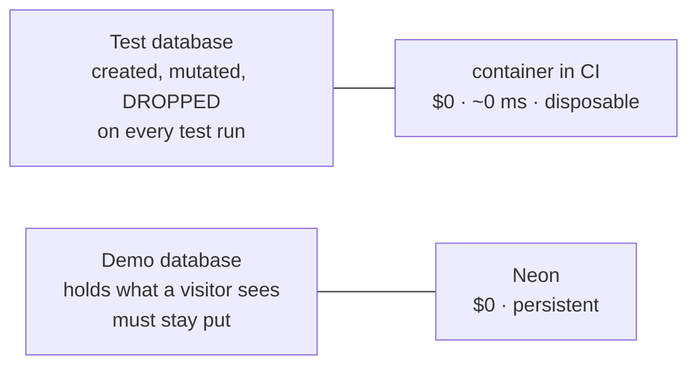

# Chapter 17 · Architecture on no budget

> Volume IV · The Practice
> Written at M1 · **partly built** — hosting lands at M7 · last verified 2026-11-14

Every component is free. Each free tier has a limit that will bite if it is not written down,
and [Chapter 7](07-the-silent-outage.md) is what happens when one is not.

## The stack and its limits

| Need | Choice | Cost | The limit that matters |
|---|---|---|---|
| Source & CI | GitHub public repo + Actions | $0 | Free and unmetered **on public repositories** |
| Database (demo) | Neon free | $0 | 1 GB/project, 100 CU-hours/month, **no expiry, no card** |
| Database (dev & test) | a container in CI | $0 | ephemeral per job; created and destroyed every run |
| API hosting | Render free web service | $0 | spins down after 15 min idle, ~50 s wake, 750 instance-hours/month |
| Web hosting | Vercel Hobby | $0 | non-commercial use only |
| Monitoring | scheduled Actions workflow | $0 | best-effort scheduling — see below |
| Browsers for E2E | Playwright in Actions | $0 | runs on the free public-repo runners |
| Domain | the provided subdomains | $0 | a custom domain adds nothing a reviewer scores |

Checked on 13 November 2026. **Free-tier terms change**; the standing instruction is to
re-verify quarterly, and the record of what was verified when lives with the project's facts.

## The decision that made CI load-bearing

Nothing installs on the development machine — no Docker, no local PostgreSQL. That is a
deliberate constraint, and it has a consequence that surfaced immediately:

> **CI is not a safety net here. It is the only way to run a single test.**

So the pipeline had to be green before any of the data-model work could start, and the feedback
loop is push-and-wait rather than save-and-see. In practice that is about eighteen seconds for
the full suite, which is less painful than it sounds — but it changes how you write. You read
the code more carefully before pushing, because the cost of being wrong is a round trip instead
of a keystroke.

It also means every claim about the code is backed by a CI run rather than by someone's memory
of running it locally, which is a better kind of evidence.

## Two databases, never one



These cannot be the same database: **every test run would wipe the demo.** That is not
duplicated setup, it is a hard requirement.

Two further reasons the suite does not run against the managed database: every query would cross
a network, and the concurrency tests hold a transaction open on one connection while a second
blocks on a row lock — behaviour that is not reliably what you are testing through a pooler.

## The keep-warm idea, and why it was dropped

The original plan pinged the API every ten minutes to defeat Render's fifteen-minute spin-down.
Two things are wrong with it.

**It does not reliably work.** GitHub's scheduled workflows are best-effort — under load they
are delayed or skipped entirely. A strategy that depends on a cron firing inside every
fifteen-minute window, all day, rests on a guarantee that does not exist.

**It is the wrong goal.** Burning roughly 420 of a 750-hour monthly allowance to make a free
tier behave like a paid one is effort spent hiding a constraint rather than handling it.

What replaced it is the same cron with a different job: **twice a day, probing
`/api/v1/health`, failing the workflow on any non-200.** That is monitoring, and it is what
would have caught the seventeen-month outage within twelve hours.

```yaml
on:
  schedule:
    - cron: "30 5 * * 1-5"   # 05:30 UTC = 11:00 local
    - cron: "0 9 * * 1-5"    # 09:00 UTC = 14:30 local
```

GitHub cron is UTC. That catches people out, so the conversion is in the comment rather than in
someone's head.

## The cold start, handled rather than hidden

The fifty-second wake does not disappear. The interface will state it — a visible *"waking the
server; this demo runs on a free tier and can take up to a minute"* once the first request
passes two seconds. That is M6 work.

This reads better than a workaround. It says the infrastructure's constraints are understood and
were handled deliberately. A blank screen for a minute says nothing — or worse, says the
application is broken, which is exactly what happened for seventeen months.

## The rule this chapter exists to state

> Before depending on any free tier, write down **what expires, when, and what happens to the
> data.**

One line — *"Render free PostgreSQL: deleted 30 days after creation plus 14 days' grace"* — is
the difference between a working demo and a year and a half of silence.

---

**Next:** [Chapter 18 · Questions and answers](README.md) — written across M3 to M5.
