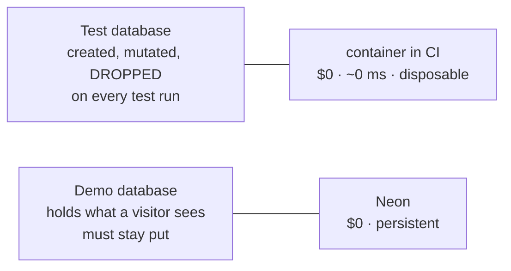

# Chapter 17 · Architecture on no budget

> Volume IV · The Practice
> Written at M1 · **partly built** — hosting lands at M7 · last verified 2026-11-14

Every component is free. Each free tier has a limit that will bite if it is not written down,
and [Chapter 7](07-the-silent-outage.md) is what happens when one is not.

## The stack and its limits

| Need | Choice | Cost | The limit that matters |
|---|---|---|---|
| Source & CI | GitHub public repo + Actions | $0 | Free and unmetered **on public repositories** |
| Database (demo) | Neon free | $0 | 1 GB/project, 100 CU-hours/month, 10 branches, **no expiry, no card**, and a compute that suspends after 5 min idle — mandatory, not configurable |
| Database (dev & test) | a container in CI | $0 | ephemeral per job; created and destroyed every run |
| API hosting | Render free web service | $0 | spins down after 15 min idle, ~50 s wake, 750 instance-hours/month |
| Web hosting | Vercel Hobby | $0 | non-commercial use only |
| Monitoring | scheduled Actions workflow | $0 | best-effort scheduling — see below |
| Browsers for E2E | Playwright in Actions | $0 | runs on the free public-repo runners |
| Domain | the provided subdomains | $0 | a custom domain adds nothing a reviewer scores |

Checked on 13 November 2026. **Free-tier terms change**; the standing instruction is to
re-verify quarterly, and the record of what was verified when lives with the project's facts.

## The decision that made CI load-bearing

Nothing installs on the development machine — no Docker, no local PostgreSQL. That is a
deliberate constraint, and it has a consequence that surfaced immediately:

> **CI is not a safety net here. It is the only way to run a single test.**

So the pipeline had to be green before any of the data-model work could start, and the feedback
loop is push-and-wait rather than save-and-see. In practice that is about eighteen seconds for
the full suite, which is less painful than it sounds — but it changes how you write. You read
the code more carefully before pushing, because the cost of being wrong is a round trip instead
of a keystroke.

It also means every claim about the code is backed by a CI run rather than by someone's memory
of running it locally, which is a better kind of evidence.

## Two databases, never one



These cannot be the same database: **every test run would wipe the demo.** That is not
duplicated setup, it is a hard requirement.

Two further reasons the suite does not run against the managed database: every query would cross
a network, and the concurrency tests hold a transaction open on one connection while a second
blocks on a row lock — behaviour that is not reliably what you are testing through a pooler.

## The branch-per-pull-request offer, and why it is declined

The provider has a GitHub integration, and it is a good one: connect the repository, and every
pull request gets its own database branch, copy-on-write and seconds old, deleted again when the
pull request closes. For a team shipping preview environments that is worth having.

It is declined here, for three reasons that are worth being able to say out loud.

**It stores an account-scoped API key in a public repository.** The integration's setup creates
a `NEON_API_KEY` secret and a `NEON_PROJECT_ID` variable. That key is not scoped to one project
or to reading — it can enumerate projects, fetch a connection URI with the password in it, and
delete branches. Repository secrets are not exposed to pull requests from forks, so the
practical exposure is small; the *blast radius* is the whole account. That is a poor trade for a
convenience, in a repository whose entire purpose is to be read by strangers.

**There is already a database in forty-five seconds.** The service container is free, unmetered,
isolated per job, and wiped afterwards. A provider branch bills compute against a 100 CU-hour
monthly allowance, caps at ten branches per project, and adds a network and an external
dependency to a job that currently has neither.

**And the thing it connects does not exist.** The payoff of a per-pull-request database is a
per-pull-request *deployment* pointed at it. There are none here and there will not be: the free
web tier is a single instance.

> An integration's value is the thing at the far end of it. Where that end does not exist, what
> remains is only its attack surface.

What is taken instead is the narrowest version that does the job: **one repository secret**
holding the connection string, and one `workflow_dispatch`-only workflow that uses it to ask the
database read-only questions about itself. That is the whole of the link between the two
accounts.

## The keep-warm idea, and why it was dropped

The original plan pinged the API every ten minutes to defeat Render's fifteen-minute spin-down.
Two things are wrong with it.

**It does not reliably work.** GitHub's scheduled workflows are best-effort — under load they
are delayed or skipped entirely. A strategy that depends on a cron firing inside every
fifteen-minute window, all day, rests on a guarantee that does not exist.

**It is the wrong goal.** Burning roughly 420 of a 750-hour monthly allowance to make a free
tier behave like a paid one is effort spent hiding a constraint rather than handling it.

What replaced it is the same cron with a different job: **twice a day, probing
`/api/v1/health`, failing the workflow on any non-200.** That is monitoring, and it is what
would have caught the seventeen-month outage within twelve hours.

```yaml
on:
  schedule:
    - cron: "30 5 * * 1-5"   # 05:30 UTC = 11:00 local
    - cron: "0 9 * * 1-5"    # 09:00 UTC = 14:30 local
```

GitHub cron is UTC. That catches people out, so the conversion is in the comment rather than in
someone's head.

## The cold start, handled rather than hidden

The wake does not disappear. The interface states it: the rebuilt frontend's first state is
*waking*, with copy naming the cause. A blank screen for a minute says nothing — or worse, says
the application is broken, which is exactly what happened for seventeen months.

## What the free tier actually charged, once it was deployed

Written on 13 November as a plan; this section was added on 18 November, after the deployment
existed. **Three of the constraints below were not in the plan**, and none of them could have
been found by reading pricing pages.

**`preDeployCommand` is paid-only, and Render rejects the entire Blueprint that declares it.**
Not the command — the whole file, on apply. `render.yaml` carried it for a day. The first
action anyone took would have been reading an error. Migrations moved into `buildCommand`,
where environment variables are available and a failing build fails the deploy, which preserves
the property that mattered: *a release whose migration fails does not replace a working
instance with a broken one.* The other free option — running migrations in the start command —
was rejected because the start command runs again after every spin-down, putting a migration
attempt in front of a cold start that is already about fifty seconds.

**HTTP request logs are Professional-and-above.** That sounds like an observability nicety. It
is not: `ProxyFix` needs a hop count that *must* be measured against the deployed stack, because
one hop too many lets a caller set their own `X-Forwarded-For` and choose their own rate-limit
bucket. With no HTTP logs there is nowhere that header appears — **a setting the code refuses
to default, specifically so it would be measured, was arranged so it could only be guessed.**
The fix was to make the application print it: gunicorn's access log format now carries
`xff=%({x-forwarded-for}i)s`.

**The subdomain was taken, so Render appended a suffix.** The service is
`file-explorer-api-xgxr.onrender.com`, not `file-explorer-api.onrender.com`. A test written the
day before asserted the literal `<name>.onrender.com` appeared in `vercel.json` — so it
**passed on the stale hostname and would have failed on the correct one.** A guard that
enforces a wrong value is worse than no guard: it is an argument against fixing the bug,
producible on demand as evidence the file was fine.

## The limit that is not the limit

Flask-Limiter's default storage is in-memory and therefore *per process*, and this deployment
runs two gunicorn workers. **Each keeps its own counter, so a caller gets the configured limit
twice over**: "10 per minute" on login is up to 20.

`config.py` has said so in a comment since M3b. `SECURITY.md` — the document somebody reads to
find out how strong a control is — did not, until it was *observed*: twelve rapid requests to
the deployed service returned two interleaved descending `X-RateLimit-Remaining` sequences
carrying **two different `X-RateLimit-Reset` values**.

That measurement nearly went the other way. A single odd reading is equally consistent with a
fixed window rolling over, and the remaining counter cannot tell the two apart. Only the reset
value can. It is the clearest example in this project of a plausible explanation that happened
to be wrong, and of the rule for avoiding them: **find the field that discriminates before
recording the fact.**

Accepted rather than fixed. A shared store needs a Redis the free tier does not have, and
dropping to one worker puts a cold start in front of the health probe. A control whose real
strength is undocumented is the worse of the two.

## The rule this chapter exists to state

> Before depending on any free tier, write down **what expires, when, and what happens to the
> data.**

One line — *"Render free PostgreSQL: deleted 30 days after creation plus 14 days' grace"* — is
the difference between a working demo and a year and a half of silence.

---

**Next:** [Chapter 18 · Questions and answers](README.md) — written across M3 to M5.
