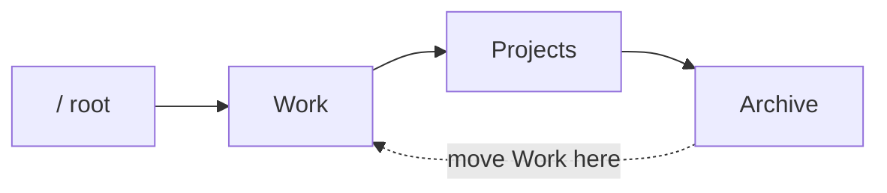
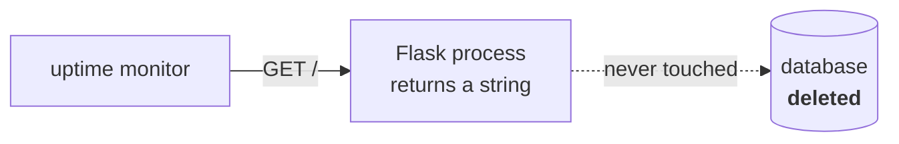
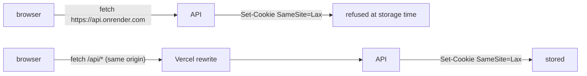

# Chapter 19 · Six deep dives

> Volume V · The Defence
> Written at M9 · last verified 2026-11-19

[Chapter 20](20-the-stories-to-tell.md) is about which stories to tell. This one is the
technical content behind six of them: **what to draw, in what order, and where the question
goes next.**

Each dive is ten minutes at a whiteboard. If you cannot draw the diagram from memory, you do not
have the dive yet — which is the honest test, and it is the reason this chapter exists as
something to practise against rather than to read.

---

## Dive 1 · Why a move can corrupt a tree that every constraint approves of

**Draw first:** four boxes and an arrow that loops.



**Say, in order:**

1. The schema is one self-referential foreign key. It guarantees the parent *row exists* and
   nothing else.
2. Move `Work` into `Archive`, which is inside `Work`. Both rows exist. The foreign key is
   satisfied. Nothing raises.
3. Now follow `parent_id` upward from `Projects`: Work → Archive → Work → Archive. It never
   reaches a root. The subtree is still in the table and no longer in the tree.
4. To the user: the folder vanished. To the database: a successful write.

**The point to land:** *this class of bug is not a crash, it is a valid write that means
something wrong* — and it is why the check has to be a statement about paths, which no
single-row constraint can express.

**Where it goes next:** "so you check for descendants before the move?" → Dive 2.

---

## Dive 2 · Why the obvious cycle check is correct and still wrong

**Draw first:** two transactions on a timeline.

```
T1:  check "is B under A?"  →  no        ... UPDATE A.parent = B
T2:        check "is A under B?"  →  no   ... UPDATE B.parent = A
                                              ↑ both legal, together a cycle
```

**Say, in order:**

1. The check runs, passes, and then the write happens. In between, the tree can change.
2. Two concurrent moves each ask about a tree that no longer exists by the time they commit.
   Each is individually correct.
3. So the check and the write have to see the same tree: **lock the ancestry chain first, then
   re-read it, then decide.**
4. Lock in a deterministic order — ascending id — or two transactions that need each other's
   rows deadlock instead of queueing.

**The point to land:** *a check is a statement about a moment.* Serialisability is not a
database feature you switch on here; it is an ordering you impose on the rows you are about to
read.

**Where it goes next:** "how did you test that?" → two transactions, real connections, a barrier
between the check and the write. Not a mock. `test_concurrent_move_four_cycle` runs four of them
at once.

---

## Dive 3 · The health check that could not fail

**Draw first:** two boxes and a dead link.



**Say, in order:**

1. The old root route returned a hardcoded string. It executed no query.
2. The database instance had been deleted. Every real request returned 500.
3. The monitor was green for seventeen months, because the thing it measured could not fail
   while the process was alive.
4. The current one runs `SELECT 1` and answers 503 when that fails, so a 200 means the database
   replied — not merely that something is listening.

**The point to land:** *a health check that does not exercise its dependency is decoration.* The
question to ask of any green dashboard is "what would have to break for this to go red?"

**Where it goes next:** "what else was lying?" → the register in
[Chapter 8](08-the-register.md), and specifically the two findings that turned out to be wrong.

---

## Dive 4 · The drop target with no pixels

**Draw first:** a list, and the container behind it.

```
┌─ <ul class="tree-root">  height = 151.1875 ────────┐
│ ┌─ <li> Documents ───────────────────────────────┐ │
│ ├─ <li> Photos ─────────────────────────────────┤ │   rows total = 151.1875
│ └─ <li> Archive ───────────────────────────────┘ │   container left over = 0
└────────────────────────────────────────────────────┘
```

**Say, in order:**

1. The drag library signals *drop on the root* by leaving the drop target undefined, which
   happens when the pointer is over the container rather than over a row.
2. The container was exactly as tall as the sum of its rows. Every pixel of it was covered.
3. So that condition could never arise from a pointer. The feature existed and was unreachable.
4. **The browser test for it was green the whole time**, because it dispatched events at the
   element by name, and `dispatchEvent` skips hit testing entirely.
5. Measured on the deployed page: 0 of 1,368 sampled points resolved to the container. After the
   fix, 465 of 465.

**The point to land:** *a test aims at an element; a person aims at a point.* Ask of every test
what it skips that a real caller cannot.

**Where it goes next:** "how do you test it now?" → the test never names the target: it asks
`document.elementFromPoint` what is under each coordinate and fails if the answer is not the
container.

### And then it happened again, which is the part worth telling

Two days later every new folder and file was landing at the top level. The cause was not the
create code: it took a parent, sent a parent, and the API accepted it. The button that supplied
a parent lived in a row's action group, and that group was `opacity: 0` until the pointer was
over that exact row. So the only control anybody could find was the one in the header, which
creates at the top level.

**The browser test for it was green**, for the same reason the drag test was green through the
bug above: Playwright clicks a control by its accessible name, and `opacity: 0` does not stop
it. Two different controls, two different mechanisms — no pixels, then no contrast — and one
test suite that could not see either, because in both cases the suite reached past the part a
person has to get past.

So the test that closes it does not click anything. It reads the computed opacity of the action
group with nothing hovered and fails if a person could not see it:

```ts
const opacity = await page
  .getByRole("button", { name: "New item inside projects" })
  .evaluate((el) => Number(getComputedStyle(el.closest(".actions")!).opacity));
expect(opacity).toBeGreaterThan(0.2);
```

> The generalisation, and it is worth saying in an interview: **for any interactive element,
> there are two questions, and a test answers only one of them.** Does it do the right thing
> when used? And can it be used? The second one needs an assertion about what is rendered — a
> size, a position, a contrast, an opacity — not about what is in the DOM.

---

## Dive 5 · Why the frontend could not sign in, and why CORS was the wrong fix

**Draw first:** two domains and a cookie that is refused.



**Say, in order:**

1. `*.vercel.app` and `*.onrender.com` are both on the Public Suffix List, so they are different
   sites, not merely different origins.
2. A `SameSite=Lax` cookie set on a cross-site request is refused **when it is stored**, not when
   it is sent. Nothing in the network tab looks wrong.
3. The usual reflex is to loosen CORS, or to set `SameSite=None`, which trades a real protection
   for a convenience.
4. Instead the frontend proxies `/api/*` to the API, so every request is same-origin. The cookie
   works for the reason it was designed to, **and CORS disappears entirely** — no preflight, no
   allow-list, no header.

**The point to land:** *the fix removed a category of problem rather than configuring it.* The
API sends no CORS header at all now, and the client enforces it: a request to an absolute URL
throws rather than being sent.

**Where it goes next:** "what does that cost?" → one more hop on every request, and a deployment
whose correctness depends on a rewrite rule that is now a committed file with a test asserting
it points at the service this repository declares.

---

## Dive 6 · Three fixes to a mechanism that was already working

**Draw first:** two arrows at the same host, one of which wakes it.

```
browser ──▶ vercel.app/api/* ──rewrite──▶ onrender.com   502 no-deploy, instantly
                                                          (and still asleep)

browser ──▶ onrender.com/api/v1/health  ──────────────▶   held open, 200 in 32.5s
                                                          (now awake)
```

**Say, in order:**

1. A free instance sleeps after fifteen idle minutes. The client retries, with a budget and a
   per-attempt ceiling, and reports the wait rather than an error.
2. It failed anyway, three times, over three days. Each time I fixed the retry: what it waited
   *on*, then how *long* each attempt was allowed. Each fix was correct and none of them worked.
3. The measurement nobody had taken: leave it asleep for sixteen minutes, then ask both
   hostnames. **Direct, the request is held open and answers in 32.5 seconds. Through the
   rewrite, 502 twelve times in 87 seconds — and the instance is still asleep afterwards.**
4. So the loop was never the defect. Every request a browser makes goes through the rewrite, and
   a request through the rewrite cannot wake the service. No budget and no ceiling could have
   succeeded.
5. The fix is four lines: once a cold start is confirmed, knock once on the API's own origin with
   an opaque `no-cors` request that reads nothing, and go on retrying the same-origin request
   whose answer the page actually needs.

**The point to land:** *when a fix does not work, the next question is not "what else is wrong
with the fix".* It is whether the thing being fixed is the thing that is broken. Three
consecutive corrections to a working mechanism is what that mistake looks like from the inside,
and it is cheap to make because each correction is individually defensible.

**Where it goes next:** "how did you verify it?" → the same way, and that is the real lesson.
The first fix was verified against mocked 502s. The second against mocked 502s. The third
against a `curl` run *during* the wait — which is what woke the service, so I recorded somebody
else's success as my own. The fourth was verified by letting the instance sleep, knocking at the
origin, and watching the rewrite path go from 502 to 200 thirty seconds later. **Every
verification but the last one tested the client instead of the path the client uses.**

---

## How to practise these

1. Draw the diagram from memory. If it comes out wrong, you do not have the dive.
2. Say the numbered points out loud, in order, without the page.
3. Have somebody ask the "where it goes next" question and answer that too — that is the part
   that separates a rehearsed story from an understood one.

Five of the six are things that were wrong in code that shipped; dive 4 has now happened twice,
and dive 6 shipped three times. The fifth — dive 2 — is the
one where the first fix was incomplete, and it is the most valuable of them for exactly that
reason.

> Do not tell dive 2 until you can draw the timeline. An interviewer who asks one follow-up past
> a memorised answer will find the edge in about fifteen seconds, and a story that collapses is
> worse than a story not told.

---

**Next:** [Chapter 20 · The stories to tell](20-the-stories-to-tell.md)
