# Chapter 21 · Reading the code, in the order it runs

> Volume VI · The Tour
> Written at M19 · every line number below was read off the file · last verified 2026-11-21

Twenty chapters explain **why** this code is shaped the way it is. None of them tells you
**where to start reading**, and that is the question anybody actually has when they open the
repository — including me, after a week away.

So: one gesture, followed from the pixel to the row and back. **Drag a folder out to the top
level.** It is the gesture this project is named after, it is the one that was broken for
eighteen months, and it touches almost everything. Fourteen files, in order, with the line to
put your cursor on.

[Chapter 22](22-the-same-tour-as-a-story.md) is this same walk told as a story, with no line
numbers. If you would rather read prose than follow a map, start there and come back.

---

## The whole path on one page

```mermaid
flowchart TB
    subgraph BROWSER["🖱️  THE BROWSER · apps/web"]
        direction TB
        M["<b>main.tsx</b> : 9<br/>createRoot().render(App)"]
        A["<b>App.tsx</b> : 39<br/>which of five states?"]
        E["<b>tree/Explorer.tsx</b> : 100<br/>holds the tree"]
        H["<b>Explorer.tsx</b> : 276<br/>handleDrop — the gesture lands"]
        T["<b>tree/model.ts</b> : 48<br/>toParentId — 0 becomes null"]
        N["<b>api/nodes.ts</b> : 87<br/>moveNode"]
        C["<b>api/client.ts</b> : 94<br/>request — the only fetch"]
        M --> A --> E --> H --> T --> N --> C
    end

    subgraph WIRE["🌐  THE WIRE · one origin, no CORS"]
        V["<b>vercel.json</b><br/>/api/* → onrender.com"]
    end

    subgraph API["🐍  THE API · apps/api"]
        direction TB
        F["<b>app.py</b> : 184<br/>create_app — order is load-bearing"]
        AU["<b>auth.py</b> : 121<br/>authenticate — cookie → g.actor_id"]
        B["<b>blueprints/nodes.py</b> : 172<br/>class Move — decode, call, shape"]
        S["<b>services/tree.py</b> : 205<br/>move — retry wrapper"]
        O["<b>services/tree.py</b> : 226<br/>_move_once — the real algorithm"]
        R["<b>repositories/node_repo.py</b> : 361<br/>lock_ancestry"]
        Q["<b>node_repo.py</b> : 94<br/>_LOCK_CHAIN — the recursive CTE"]
        F --> AU --> B --> S --> O --> R --> Q
    end

    DB[("🐘  PostgreSQL<br/>FOR NO KEY UPDATE")]

    C ==>|"POST /api/v1/nodes/7/move<br/>{new_parent_id: null}"| V
    V ==> F
    Q ==> DB
    DB -.->|"200 · the moved row"| C

    style M fill:#fef3c7,stroke:#d97706,stroke-width:2px,color:#000
    style A fill:#fde68a,stroke:#d97706,stroke-width:2px,color:#000
    style E fill:#fcd34d,stroke:#d97706,stroke-width:2px,color:#000
    style H fill:#fbbf24,stroke:#b45309,stroke-width:3px,color:#000
    style T fill:#f59e0b,stroke:#b45309,stroke-width:3px,color:#000
    style N fill:#fbbf24,stroke:#b45309,stroke-width:2px,color:#000
    style C fill:#f59e0b,stroke:#b45309,stroke-width:2px,color:#000
    style V fill:#a7f3d0,stroke:#059669,stroke-width:3px,color:#000
    style F fill:#bfdbfe,stroke:#2563eb,stroke-width:2px,color:#000
    style AU fill:#93c5fd,stroke:#2563eb,stroke-width:2px,color:#000
    style B fill:#60a5fa,stroke:#1d4ed8,stroke-width:2px,color:#fff
    style S fill:#3b82f6,stroke:#1d4ed8,stroke-width:2px,color:#fff
    style O fill:#2563eb,stroke:#1e40af,stroke-width:3px,color:#fff
    style R fill:#1d4ed8,stroke:#1e3a8a,stroke-width:2px,color:#fff
    style Q fill:#1e40af,stroke:#1e3a8a,stroke-width:3px,color:#fff
    style DB fill:#312e81,stroke:#1e1b4b,stroke-width:3px,color:#fff
```



**The three colours are the three places a bug can live**, and this project has had one of each.
Amber is the browser, where F-06 lived for eighteen months — the client could not say `null`.
Green is the one hop, where F-77 lives — the host, throttling a wake-up, which no code of ours
can fix. Blue is the API, where the cycle check lives, and where M3a's blocking defect sat
between two individually correct statements.

---

## Stop 1 · `apps/web/src/main.tsx`, line 9

Thirteen lines, and the whole file is worth reading because two of them are decisions.

```tsx
createRoot(root).render(
  <StrictMode>
    <App />
  </StrictMode>,
);
```

`StrictMode` double-invokes every effect in development. That is not a nuisance to be switched
off — **it found a real defect.** M8's Gate 3 reported that the second session check also saw a
502, found a wake already running, and replaced the waiting panel with
`request failed with 502`, the exact string that milestone existed to delete. Playwright serves
a *production* build, where StrictMode does not double-invoke, so **no browser test could ever
have found it.** Keep it on.

And `if (!root) throw` rather than `root!`. A non-null assertion would turn a missing `#root`
into an error about `null` somewhere inside React. The throw names the actual problem.

---

## Stop 2 · `apps/web/src/App.tsx`, line 39

The shell. Read the `State` union in `failure.ts` first, because the component is a switch over
it:

```ts
type State =
  | { kind: "resolving" }
  | { kind: "waking"; seconds: number }
  | { kind: "anonymous" }
  | { kind: "signed-in"; who: WhoAmI }
  | { kind: "failed"; message: string; status?: number; canWake: boolean };
```

**The April 2025 client had one state.** It called an API returning 500, caught the error, wrote
it to `console.error`, and rendered an empty tree for seventeen months. That is F-01, and the
union above is the fix: there is no state in which something failed and the page shows a tree.

Then read `explainFailure` in **`apps/web/src/failure.ts`**, which is the only place in the
frontend that turns an exception into a sentence. It is 109 lines for five branches because
every branch is a bug that reached a visitor.

---

## Stop 3 · `apps/web/src/tree/Explorer.tsx`, line 100

868 lines, the largest file in the project, and the one to read with the most suspicion — **six
of the ten defects a person found live in this file.**

Read in this order:

| Line | What | Why it is here |
|---|---|---|
| 110 | `adding` state, with its `fixed` flag | F-76 · the `+` on a row settles the destination, so the form states it instead of asking again |
| 205 | `openChanged` | Lazy loading. A folder is fetched the first time it is opened, and `loaded` is marked **after** the request succeeds — marking it first left one 503 looking like an empty folder for ever |
| 276 | `handleDrop` | The gesture lands here |
| 377 | `folderChoices` | Builds the path-labelled destination list |
| 455 | `crumbsFor` usage | The breadcrumb — chapter 17's `GET /nodes/{id}/path` computed in the page instead |
| 620 | the `<Tree>` render prop | Every row. Note there is **no `canDrop` prop**, and the docblock says why |

**The missing prop is the most important thing in the file.** A custom `canDrop` replaces four
of the library's rules rather than adding one, which is F-37, which is the same line of code as
F-06. [Chapter 13](13-the-client-that-could-not-say-null.md) reads the compiled bundle.

---

## Stop 4 · `apps/web/src/tree/model.ts`, line 48

Four lines, and they are the whole of F-06.

```ts
export function toParentId(parent: NodeModel["id"]): number | null {
  if (parent === ROOT_ID || parent === "0") return null;
  return typeof parent === "number" ? parent : Number(parent);
}
```

The drag library calls the root `0`. The API calls it `null`. `0` is a perfectly good node id;
`null` is not a value the library understands. **A client that does not translate cannot express
"move this to the root" at all** — and for eighteen months it did not, silently, with no error
in any log.

If this returned `0`, the API would be asked to re-parent the node *under node zero*, get a 404,
and the feature would silently not exist again in a new way. That is why a unit test pins
`toParentId(ROOT_ID) === null` specifically.

---

## Stop 5 · `apps/web/src/api/client.ts`, line 94

Every request in the application goes through this one function, and the first four lines are a
guard rather than logic:

```ts
if (!path.startsWith("/api/")) {
  throw new Error(`refusing a non-relative request to ${path}: it would bypass the rewrite`);
}
```

An absolute URL would be cross-site, and a `SameSite=Lax` cookie is **refused at storage time**
on a cross-site response. So the session would silently never exist — which is what the April
2025 client did, with `baseURL: "https://file-explorer-backend.onrender.com/api"`. It throws
rather than returning an error because that is a programming mistake, not a runtime condition.

CI also greps the built bundle for the hostname, because a relative URL and an absolute one look
identical in review.

---

## Stop 6 · `vercel.json` — the hop with no code

```json
{ "rewrites": [{ "source": "/api/:path*", "destination": "https://file-explorer-api-xgxr.onrender.com/api/:path*" }] }
```

Four lines of configuration doing more work than any file in the repository. Because of it the
browser only ever talks to one origin: the cookie is same-site, `Lax` is correct, and **CORS
disappears entirely** — the API sends no CORS header at all.

Two things to know before you trust it:

- **`-xgxr` is not a typo.** The bare subdomain was taken, so Render appended a suffix. A test
  written the day before asserted the literal `<name>.onrender.com`, so it **passed on the stale
  hostname and would have failed on the correct one.**
- **A request through this rewrite cannot wake a sleeping instance.** 502 twelve times in 87
  seconds, measured, with the instance still asleep afterwards. That is why
  `apps/web/src/api/wake.ts:104` knocks on the API's own origin with an opaque `no-cors` request
  before retrying here. [Chapter 19](19-five-deep-dives.md), dive 6.

---

## Stop 7 · `apps/api/src/file_explorer/app.py`, line 184

`create_app`, and **the order of the lines is the content.** Three bugs in this project were
registration-order bugs, in two directions:

```python
app.after_request(_strip_retry_after)   # registered FIRST so it runs LAST
...
limiter.init_app(app)                   # ← the pivot
...
app.before_request(refuse)              # registered AFTER so it runs after the limiter
problems.register(app)                  # AFTER Api(app), or smorest's handler wins
```

Flask runs `before_request` in registration order and `after_request` in **reverse**. So:

- The `Retry-After` strip had to be registered **first** so it would run **last** — registered
  after the limiter it ran before it, and the header was added straight back. Dead code, and
  only a test driving a real 429 noticed.
- `authenticate` had to be registered **before** `limiter.init_app` so the session is resolved
  before the limiter asks for a key. Registered after, keying the rate limit on the session
  **did nothing at all**, and every test but one passed.
- `problems.register` has to come **after** `Api(app)`, because Flask keeps error handlers in a
  dict keyed by exception class and the later registration *replaces* the earlier one.

Then read `_assert_the_cookie_can_reach_us` and `_assert_the_limiter_can_tell_callers_apart`
further down. Both refuse to start the application rather than serving a broken one, and both
exist because the condition they check **cannot be seen by any HTTP test** — the contradiction
is between two pieces of configuration.

---

## Stop 8 · `apps/api/src/file_explorer/auth.py`, line 121

Three hooks, and their comments are mostly about *when* they run rather than what they do. The
cookie carries 32 random bytes; the table stores their SHA-256, so a leaked backup yields
nothing presentable. SHA-256 rather than Argon2 deliberately: a 256-bit random token is not
guessable at any speed, so slowness would cost a memory-hard hash on **every request** and buy
nothing.

`require_actor()` now *reads* `g.actor_id` rather than computing it. It stays a function because
it is the seam that made M5 a one-file change, and because it fails closed if a future route is
ever reached without the hook.

---

## Stop 9 · `apps/api/src/file_explorer/blueprints/nodes.py`, line 172

```python
@blp.route("/nodes/<int:node_id>/move")
class Move(MethodView):
    def post(self, body, node_id):
        return tree_service().move(require_actor(), node_id, body["new_parent_id"])
```

**Every route in this file is this short, and that is a rule rather than a style.** The
concurrency tests drive `TreeService` on two real connections; they cannot reach a rule that
lives in a route. A rule in the HTTP layer is a rule those tests cannot test.

A `POST` on its own path rather than `PATCH /nodes/{id}` with a `parent_id` field: moving is not
a field assignment. It has failure modes rename does not — a cycle, the depth cap, a file as the
destination, contention — and folding it into rename means a request that only wanted to change
a name can come back with any of them.

---

## Stop 10 · `apps/api/src/file_explorer/services/tree.py`, lines 205 and 226

**This is the destination.** Everything above is plumbing; this is the thing the project is about.

`move` at 205 is only the retry wrapper. `_move_once` at 226 is the algorithm, in four steps, and
every one of them was wrong in an earlier version:

```
1. lock the moved node + the destination's ancestry chain, ORDER BY id, FOR NO KEY UPDATE
2. RE-RUN the ancestry walk as a NEW STATEMENT          ← step 2 is the whole chapter
3. check the measured chain is a subset of the locked set
4. UPDATE nodes SET parent_id = ... WHERE id = ... AND owner_id = ...
```

Read [chapter 10](10-the-race-nobody-sees.md) beside this function. The four things worth
knowing, each of which was discovered the hard way:

1. **The lock that does the work is on the moved node**, not the destination chain. Get this
   backwards and you write the two-node test, which **passes against a broken implementation.**
2. **Step 2 must be a genuinely new statement.** `FOR NO KEY UPDATE` does not refresh a
   recursive CTE — `LockRows` sits above the plan and EvalPlanQual re-checks only the outer qual.
   Reusing step 1's rows admits a four-node cycle.
3. **Step 3 exists because of a Gate 3 BLOCK.** `create` locked a chain chosen under one
   snapshot and measured another, so a move committing during the lock wait left the upper chain
   unlocked. Reproduced at level 7 against a cap of 6.
4. `FOR NO KEY UPDATE`, not `FOR UPDATE` — the latter conflicts with the `FOR KEY SHARE` an
   `INSERT` takes on its parent, so it would block anyone creating a node underneath the chain.

---

## Stop 11 · `apps/api/src/file_explorer/repositories/node_repo.py`, lines 41 and 94

529 lines, almost all of it SQL in `text()` blocks. The two to read:

- **`_ANCESTRY`, line 41** — walks up. Note the owner predicate is in the **recursive term** as
  well as the anchor. Filtering only the anchor lets the walk climb straight out of your tree
  and return a stranger's folder names.
- **`_LOCK_CHAIN`, line 94** — the same walk, ending in `ORDER BY id FOR NO KEY UPDATE`.

Both carry `a.depth < :max_depth`, and the bound is not only a denial-of-service guard. A
bounded walk **does not fail** when the chain is longer than the bound — it stops and returns
what it has, which is indistinguishable from a complete answer. Hand that to the cycle check and
it misses a real ancestor. **I7 is what keeps I1 sound**, which is why both walks raise
`TreeTooDeep` rather than returning a short answer.

A test reads this file and counts the owner predicates per statement. It was wrong twice: the
first version asked only whether the SQL mentioned `owner_id` *at all* — vacuous — and the
second walked only module-level assignments, missing **seven of the twenty-two predicates that
live inside methods.**

---

## Where to go next, by what you want

| If you want | Open | Then read |
|---|---|---|
| the hardest thing here | `services/tree.py:226` | [ch 10](10-the-race-nobody-sees.md) |
| the bug the project is named after | `models/node.py` + `services/tree.py:226` | [ch 5](05-the-cycle.md) |
| why the demo was dead for 17 months | `app.py` health route | [ch 7](07-the-silent-outage.md) |
| what a test can fail to notice | `apps/web/e2e/root-drop-zone.spec.ts` | [ch 14](14-testing-what-matters.md) |
| why the frontend could not sign in | `api/client.ts:94` + `vercel.json` | [ch 13](13-the-client-that-could-not-say-null.md) |
| every defect and how it was found | `docs/MUTATIONS.md` | [ch 8](08-the-register.md) |

---

## The one thing to notice about this tour

Count the stops where the interesting content is a **comment about ordering, absence, or a
default**: stop 1 (StrictMode on purpose), stop 3 (a prop deliberately not passed), stop 5 (a
throw instead of a return), stop 7 (three registration-order traps), stop 11 (a predicate in the
recursive term).

That is five of eleven. **The code in this repository is not hard to read. What is hard is seeing
what is not there** — and that is why nearly every file carries a comment explaining an absence,
and why a test asserts that `canDrop` does not appear. A guard whose reason is not written beside
it gets removed by somebody tidying up.

---

**Next:** [Chapter 22 · The same tour, as a story](22-the-same-tour-as-a-story.md)
